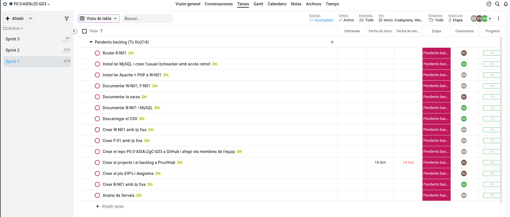
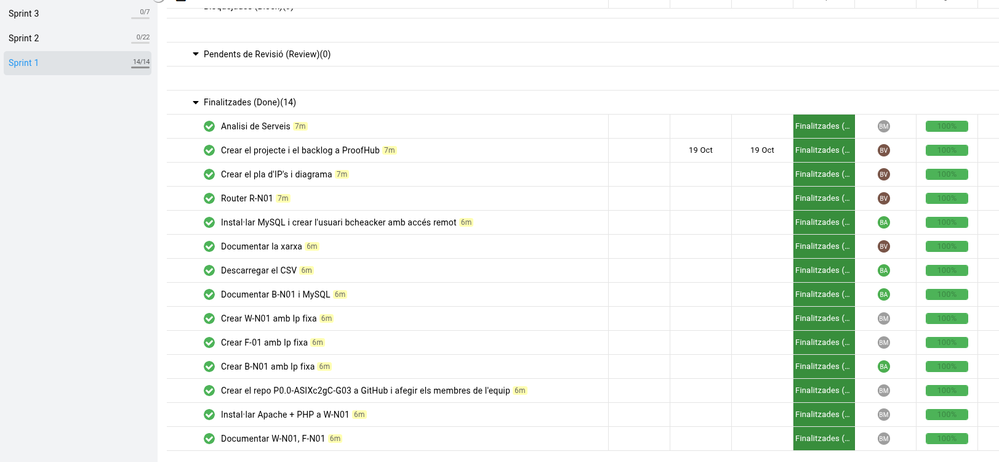
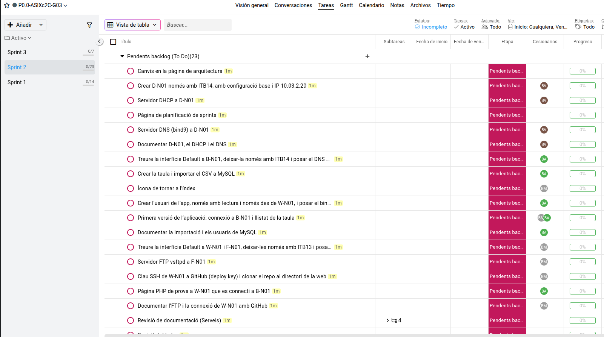
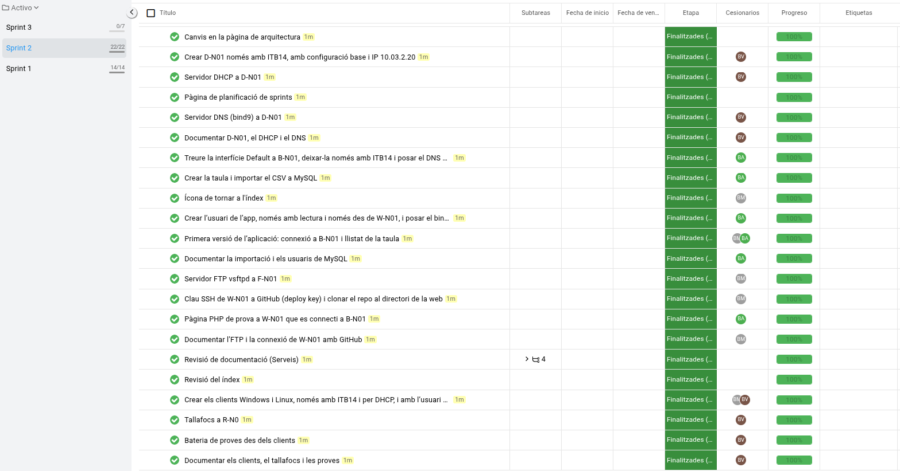
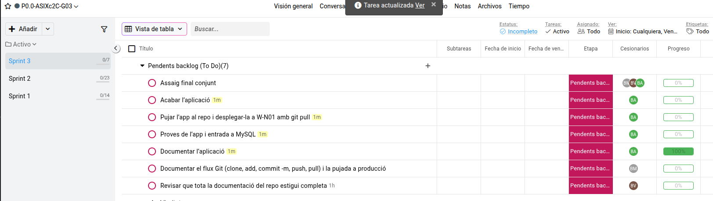
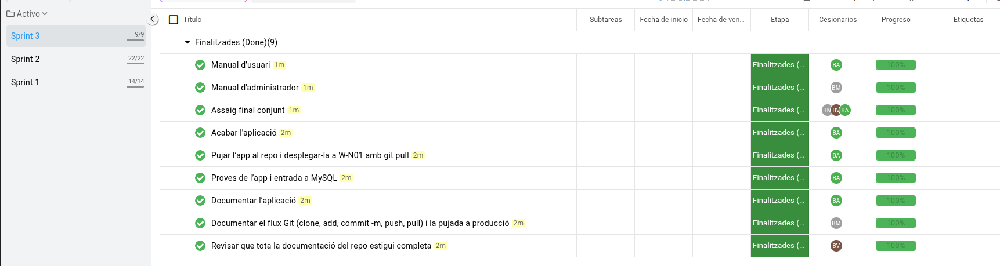

# Equip i planificació dels sprints

Aquest document explica com està organitzat el treball del grup: qui fa cada part, quines tasques té cadascú, què s'ha fet a cada sprint i com ha evolucionat la planificació. L'estat de cada sprint es mostra amb les captures del tauler de ProofHub a l'inici i al final.

---

## 1. Equip i rols

| Membre | Rol | Màquines | Responsabilitat |
|---|---|---|---|
| Victor Barreda | Xarxa | R-N01, D-N01, PC Windows, PC Linux | Router, tallafocs, DNS, DHCP i clients |
| Adam Ben Mansor | Dades | B-N01 | MySQL, importació del CSV i aplicació web |
| Marc Balastegui | Web i Git | W-N01, F-N01 | Servidor web, FTP, repositori GitHub i desplegament |

**Criteri del repartiment.** Cada persona és responsable de la seva part de principi a fi: crea les seves màquines, les configura, les prova i en fa la documentació. Així ningú depèn de la feina dels altres per avançar.

**Regles comunes a tot l'equip:**

- **Configuració base:** igual a totes les màquines: hostname, IP fixa, usuari `bchecker` amb sudo, SSH actiu i zona horària Europe/Madrid.
- **Estructura de documentació:** igual per a tothom: creació de la màquina (adaptadors i recursos), configuració base i serveis, cadascú amb la seva comprovació i captures.
- **Tasques a ProofHub:** amb responsable i dependències marcades. Cada tasca passa de *Pendents backlog (To Do)* a *Finalitzades (Done)* quan està feta i comprovada.

---

## 2. Planificació general

El projecte es divideix en tres sprints:

| Sprint | Objectiu | Resultat esperat al final |
|---|---|---|
| **1. Xarxa base i màquines** | Crear i configurar les màquines i la xarxa base, excepte el DHCP i el DNS | El router funciona amb NAT, i totes les màquines estan creades i configurades |
| **2. Serveis** | Cada servei funciona correctament | DHCP i DNS, MySQL amb les dades del CSV, FTP, Apache, clau SSH per al desplegament, tallafocs i clients |
| **3. Revisió i tancament** | Tot funciona de principi a fi i està documentat | Aplicació acabada i desplegada, manuals, documentació revisada i assaig final |

### Dependències entre tasques

- **El router bloqueja gairebé tot.** Les altres màquines no tenen sortida a Internet fins que R-N01 funciona. Per això és la primera tasca del Sprint 1.
- **La importació del CSV bloqueja l'aplicació.** Sense les dades a MySQL, l'aplicació no té res a mostrar.
- **El tallafocs va després dels serveis.** Es configura quan els serveis ja funcionen. Si es fa abans i alguna cosa falla, no es pot saber si és per la regla o pel servei.
- **Les màquines sense Default depenen del router.** Quan R-N01 està operatiu, es treu la interfície Default a les màquines de la DMZ i la Intranet, i només queden amb ITB13 o ITB14.

---

## 3. Sprint 1 – Xarxa base i màquines

### Tasques

| Persona | Tasca |
|---|---|
| **Victor** | Crear el projecte i el backlog a ProofHub |
| | Anàlisi de serveis |
| | Pla IP i diagrama d'arquitectura |
| | Crear R-N01 des de la plantilla d'Isard: configuració base, interfícies, reenviament i NAT |
| | Documentar el router i el pla IP |
| **Adam** | Crear B-N01 des de la plantilla d'Isard amb IP 10.3.2.10 |
| | Instal·lar MySQL i crear l'usuari bchecker amb accés remot |
| | Descarregar el CSV, analitzar-lo i preparar l'esquema de la taula |
| | Documentar B-N01 i MySQL |
| **Marc** | Anàlisi de serveis |
| | Crear el repositori GitHub amb l'esquema de directoris complet i afegir-hi l'equip |
| | Crear W-N01 i F-N01 des de la plantilla d'Isard amb les IPs 10.3.1.20 i 10.3.1.10 |
| | Instal·lar Apache i PHP a W-N01 |
| | Documentar W-N01 i F-N01 |

### Inici del sprint

El sprint comença amb les 14 tasques al backlog (*Pendents backlog*), totes al 0%.

*Tauler de ProofHub a l'inici del Sprint 1: 14 tasques pendents.*

### Què hem fet

**Organització i disseny.** S'ha creat el projecte a ProofHub amb el backlog dels tres sprints, i s'han analitzat els serveis que demana l'enunciat per decidir quines màquines calien i on anava cadascuna. A partir d'aquí s'ha fet el pla d'adreçament i el diagrama d'arquitectura: la DMZ a 10.3.1.0/24 (ITB13), la Intranet a 10.3.2.0/24 (ITB14) i una IP fixa per a cada servidor.

**Router (Victor).** R-N01 s'ha creat a partir de la plantilla Ubuntu Server 24.04, amb quatre adaptadors: Default (sortida a Internet), ITB13 (gateway de la DMZ, 10.3.1.1), ITB14 (gateway de la Intranet, 10.3.2.1) i la VPN d'Isard per a l'administració remota. S'hi ha aplicat la configuració base, el netplan, el reenviament de paquets i el NAT amb una regla `MASQUERADE` persistent.

**Base de dades (Adam).** S'ha creat B-N01 a la Intranet amb la IP 10.3.2.10, s'hi ha instal·lat MySQL i s'ha creat l'usuari `bchecker` amb accés remot. També s'ha descarregat el CSV de dades i s'ha analitzat per definir l'esquema de la taula.

**Web i Git (Marc).** S'ha creat el repositori `P0.0-ASIXc2gC-G03` a GitHub amb l'estructura de directoris (`app/`, `config/`, `docs/`, `sql/`) i s'hi ha afegit l'equip. S'han creat W-N01 i F-N01 a la DMZ, amb les IPs 10.3.1.20 i 10.3.1.10, i s'ha instal·lat Apache i PHP a W-N01.

**Incidències:**

- **El NAT no comptava paquets.** El comptador de la regla `MASQUERADE` es mantenia a 0 perquè W-N01 encara tenia la ruta per defecte per la interfície Default, i el trànsit no passava pel router. Es va solucionar posant la ruta per defecte via 10.3.1.1.
- **El reenviament no s'aplicava.** El fitxer de `sysctl` s'havia creat sense l'extensió `.conf`, i `sysctl --system` l'ignorava. Es va reanomenar a `99-router.conf`.

### Final del sprint

Les 14 tasques estan finalitzades al 100%.

*Tauler de ProofHub al final del Sprint 1: 14 de 14 tasques finalitzades.*

---

## 4. Sprint 2 – Serveis

### Tasques

| Persona | Tasca |
|---|---|
| **Victor** | Crear D-N01 des de la plantilla d'Isard, amb configuració base i IP 10.3.2.20 |
| | Servidor DHCP a D-N01: rang 10.3.2.100–200, gateway 10.3.2.1 |
| | Servidor DNS (bind9) a D-N01: registres de totes les màquines i reenviament a un DNS públic |
| | Documentar D-N01, DHCP i DNS |
| | Tallafocs a R-N01 |
| | Crear els clients Windows i Linux, només amb ITB14 i per DHCP, i amb l'usuari bchecker |
| | Bateria de proves des dels clients: DHCP, DNS (R i R-N01), web, FTP i tallafocs |
| | Documentar els clients, el tallafocs i les proves |
| **Adam** | Treure la interfície Default de B-N01 i posar-hi el DNS 10.3.2.20 |
| | Crear la taula i importar el CSV a MySQL, comprovant el nombre de files i els accents |
| | Crear l'usuari de l'aplicació, només de lectura i només des de W-N01 |
| | Pàgina PHP de prova a W-N01 que es connecti a B-N01 |
| | Primera versió de l'aplicació: connexió a B-N01 i llistat de la taula |
| | Documentar la importació i els usuaris de MySQL |
| **Marc** | Treure la interfície Default de W-N01 i F-N01 i posar-hi el DNS 10.3.2.20 |
| | Servidor FTP vsftpd a F-N01: usuaris locals, engabiats i ports passius fixos |
| | Clau SSH de W-N01 a GitHub (deploy key) i clonar el repositori al directori de la web |
| | Crear els clients Windows i Linux, juntament amb Victor |
| | Icona de tornar a l'índex a la documentació |
| | Documentar l'FTP i la connexió de W-N01 amb GitHub |
| **Equip** | Canvis a la pàgina d'arquitectura, pàgina de planificació de sprints, revisió de la documentació dels serveis i revisió de l'índex |

### Inici del sprint

El sprint comença amb 23 tasques al backlog.

*Tauler de ProofHub a l'inici del Sprint 2: 23 tasques pendents.*

### Què hem fet

**DNS i DHCP (Victor).** S'ha creat D-N01 a la Intranet, només amb l'adaptador ITB14 i la IP 10.3.2.20. S'hi ha instal·lat el servidor DHCP (`isc-dhcp-server`), que només escolta a la Intranet i reparteix IPs del rang 10.3.2.100–200 amb el gateway 10.3.2.1, el DNS 10.3.2.20 i el domini `g03.intra`. També s'hi ha configurat el DNS amb bind9: una zona directa (`g03.intra`) amb totes les màquines i l'àlies `R`, dues zones inverses (una per a la DMZ i una per a la Intranet) i el reenviament a 8.8.8.8 per als noms d'Internet. S'ha comprovat amb `dig` que resol els noms interns, els inversos i els externs.

**Tallafocs (Victor).** S'han afegit cinc regles a la cadena `FORWARD` de R-N01: de la DMZ cap a la Intranet només es permet W-N01 → B-N01 pel port 3306 (MySQL) i la DMZ → D-N01 pel port 53 (DNS). La resta del trànsit de la DMZ cap a la Intranet es descarta. S'ha comprovat des de F-N01, W-N01 i un client, i amb els comptadors de cada regla.

**Clients (Victor i Marc).** S'han creat els clients Windows i Linux, només amb ITB14 i en mode DHCP, amb l'usuari `bchecker` i els hostnames `PC-Windows` i `PC-Linux`. El client Windows ha rebut la IP 10.3.2.103 amb el gateway, el DNS i el domini correctes.

**Base de dades i aplicació (Adam).** S'ha deixat B-N01 només amb ITB14 i el DNS 10.3.2.20. S'ha creat la taula i s'ha importat el CSV a MySQL, comprovant el nombre de files i que els accents es veiessin bé. S'ha creat l'usuari de l'aplicació, que només té permís de lectura i només es pot connectar des de W-N01. S'ha fet una pàgina PHP de prova i la primera versió de l'aplicació, que es connecta a B-N01 i mostra el llistat de la taula.

**Web, FTP i Git (Marc).** S'ha configurat el servidor FTP vsftpd a F-N01, amb usuaris locals engabiats al seu directori i ports passius fixos. S'ha creat una clau SSH a W-N01, s'ha afegit a GitHub com a *deploy key* i s'ha clonat el repositori al directori de la web. També s'ha afegit una icona de tornar a l'índex a la documentació, perquè sigui més fàcil moure's entre pàgines.

**Canvis respecte a la planificació inicial:**

- **Tasques avançades del Sprint 3.** El tallafocs, els clients i la bateria de proves estaven previstos per al Sprint 3, però es van fer en aquest sprint, un cop els serveis ja funcionaven. Per això el Sprint 3 ha quedat dedicat a la revisió i el tancament.
- **Tasques de l'equip.** S'han afegit tasques compartides de documentació: canvis a la pàgina d'arquitectura, la pàgina de planificació de sprints, la revisió de la documentació dels serveis i la revisió de l'índex.
- **De 23 a 22 tasques.** La tasca *Treure la interfície Default a W-N01 i F-N01* era al backlog inicial i no apareix al tauler final.

### Final del sprint

Les 22 tasques estan finalitzades al 100%.

*Tauler de ProofHub al final del Sprint 2: 22 de 22 tasques finalitzades.*

---

## 5. Sprint 3 – Revisió i tancament

### Tasques

| Persona | Tasca |
|---|---|
| **Victor** | Revisar que tota la documentació del repositori estigui completa |
| | Assaig final conjunt |
| **Adam** | Acabar l'aplicació: taula HTML, paginació i cercador |
| | Pujar l'aplicació al repositori i desplegar-la a W-N01 amb `git pull` |
| | Proves de l'aplicació i accés amb bchecker a MySQL |
| | Documentar l'aplicació |
| | Manual d'usuari |
| | Assaig final conjunt |
| **Marc** | Documentar el flux Git (`clone`, `add`, `commit`, `push`, `pull`) i la pujada a producció |
| | Manual d'administració |
| | Assaig final conjunt |

### Inici del sprint

El sprint comença amb 7 tasques al backlog.

*Tauler de ProofHub a l'inici del Sprint 3: 7 tasques pendents.*

### Què hem fet

**Aplicació (Adam).** S'ha acabat l'aplicació web, que mostra les dades del CSV en una taula HTML amb paginació i un cercador. S'ha pujat al repositori i s'ha desplegat a W-N01 amb `git pull`, i s'ha provat l'aplicació i l'accés amb `bchecker` a MySQL. També s'ha documentat l'aplicació i s'ha fet el manual d'usuari.

**Git i administració (Marc).** S'ha documentat el flux de treball amb Git (`clone`, `add`, `commit`, `push`, `pull`) i com es puja una nova versió a producció. També s'ha fet el manual d'administració.

**Revisió de la documentació (Victor).** S'ha revisat que tots els documents del repositori estiguin complets, que segueixin la mateixa estructura i que els enllaços de l'índex i de les captures funcionin.

**Assaig final conjunt (equip).** S'han engegat totes les màquines en ordre (R-N01, D-N01, B-N01, W-N01, F-N01 i els clients) i s'han repetit les proves de principi a fi.

**Incidència de l'assaig final.** B-N01 no podia fer ping a W-N01. Amb `tcpdump` es va veure que el ping arribava a W-N01, però la resposta sortia per l'adaptador de la VPN (`enp2s0`) i no per la DMZ. La causa és la ruta `10.0.0.0/14` que afegeix la VPN d'Isard, que inclou les adreces 10.3.2.x i és més específica que la ruta per defecte. La solució és afegir al netplan de W-N01 una ruta explícita a la Intranet (`10.3.2.0/24 via 10.3.1.1`), que té preferència sobre la de la VPN.

**Canvis respecte a la planificació inicial:**

- **De 7 a 9 tasques.** Durant el sprint es van afegir dues tasques: el *Manual d'usuari* (Adam) i el *Manual d'administrador* (Marc).

### Final del sprint

Les 9 tasques estan finalitzades al 100%.

*Tauler de ProofHub al final del Sprint 3: 9 de 9 tasques finalitzades.*
