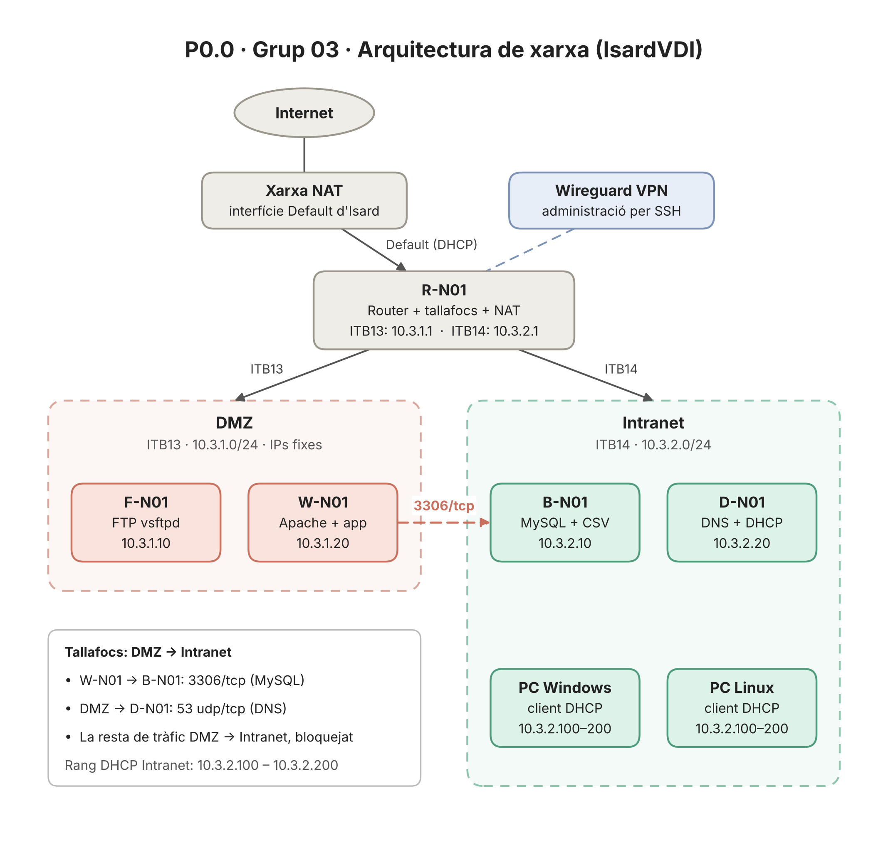

# Xarxa: pla d'adreçament i diagrama

## Xarxes d'IsardVDI

| Interfície d'Isard | Ús | Subxarxa |
|---|---|---|
| Default | NAT: sortida a Internet | DHCP d'Isard |
| ASIXC2-ITB13 | DMZ | 10.3.1.0/24 |
| ASIXC2-ITB14 | Intranet | 10.3.2.0/24 |
| ITB13a / ITB14a | Reserva | — |
| Wireguard VPN | Accés d'administració des de fora | VPN d'Isard |

## Pla d'adreçament

| Equip | Funció | Interfícies | IP | Gateway | DNS |
|---|---|---|---|---|---|
| R-N01 | Router, tallafocs i NAT | Default, ITB13, ITB14, VPN | DHCP / 10.3.1.1 / 10.3.2.1 / VPN | Default | 10.3.2.20 (temporal: 8.8.8.8 fins que D-N01 estigui operatiu) |
| F-N01 | FTP (vsftpd) | ITB13 | 10.3.1.10 | 10.3.1.1 | 10.3.2.20 |
| W-N01 | Web (Apache + app) | ITB13 | 10.3.1.20 | 10.3.1.1 | 10.3.2.20 |
| B-N01 | BBDD (MySQL) | ITB14 | 10.3.2.10 | 10.3.2.1 | 10.3.2.20 |
| D-N01 | DNS + DHCP | ITB14 | 10.3.2.20 | 10.3.2.1 | 127.0.0.1 |
| PC Windows | Client | ITB14 | DHCP | DHCP | DHCP |
| PC Linux | Client | ITB14 | DHCP | DHCP | DHCP |

- **Rang DHCP (Intranet):** 10.3.2.100 – 10.3.2.200
- **Reservades per a futures màquines:** 10.3.1.2–9 (DMZ) i 10.3.2.2–9 (Intranet)
- **Registres DNS previstos:** R-N01 → 10.3.2.1; R → àlies de R-N01; F-N01, W-N01, B-N01 i D-N01 amb la seva IP.

## Diagrama d'arquitectura

**Figura 10** · 

## Justificació del disseny
 
**Tres xarxes separades.** La infraestructura es divideix segons qui ha de poder accedir a cada servei:
 
| Xarxa | Funció | Equips |
|---|---|---|
| NAT | Connexió amb l'exterior | Només R-N01 |
| DMZ | Serveis que s'ofereixen cap a fora | F-N01, W-N01 |
| Intranet | Serveis i equips interns, no exposats | B-N01, D-N01, clients |
 
Separar-les fa que, si un servei exposat queda compromès, l'atacant no tingui accés directe a la resta de la xarxa.
 
**Per què el web i l'FTP són a la DMZ.** Són els serveis pensats per ser consultats des de fora de l'organització. Posar-los en una xarxa pròpia permet obrir-los a l'exterior sense obrir també la xarxa interna.
 
**Per què la base de dades és a la Intranet i no a la DMZ.** Les dades són l'actiu més valuós i no s'han de poder consultar des de fora. L'aplicació web les necessita, però no cal que siguin al costat: W-N01 s'hi connecta a través del router, només pel port de MySQL (3306). Si algú comprometés el servidor web, la base de dades no seria a la mateixa xarxa.
 
**Per què el DNS i el DHCP són a la Intranet.** El DHCP funciona per difusió (*broadcast*): el client, que encara no té IP, envia una petició a tota la seva xarxa. Aquests missatges no travessen el router, de manera que el servidor DHCP ha de ser al mateix segment que els clients que l'han de fer servir.
 
**Per què un sol router.** Tot el trànsit entre xarxes, i cap a Internet, passa per R-N01. Això el converteix en l'únic punt on cal controlar què pot anar d'una xarxa a l'altra: fa el NAT perquè la DMZ i la Intranet surtin a Internet, i és on s'aplica el tallafocs.
 
**IP fixa als servidors i DHCP als clients.** Els servidors han de tenir sempre la mateixa adreça perquè els altres equips els puguin trobar. Els clients poden canviar d'adreça sense cap problema, i el DHCP evita haver-los de configurar un a un.

*Arquitectura de xarxa del grup 03. Les úniques connexions permeses de la DMZ cap a la Intranet són W-N01 → B-N01 pel port 3306/tcp i la DMZ → D-N01 pel port 53 (DNS).*

## Tallafocs previst (Sprint 3)

| Origen | Destí | Permès |
|---|---|---|
| W-N01 (10.3.1.20) | B-N01 (10.3.2.10) | 3306/tcp (MySQL) |
| DMZ (10.3.1.0/24) | D-N01 (10.3.2.20) | 53 udp/tcp (DNS) |
| Resta de la DMZ | Intranet | Bloquejat |

## Nota sobre la VPN

La VPN d'Isard rep una ruta `10.0.0.0/14`, que inclou els rangs 10.3.x.x. Les rutes directes de les subxarxes internes (`10.3.1.0/24` i `10.3.2.0/24`) són més específiques i tenen preferència, de manera que el trànsit intern mai surt per la VPN.
