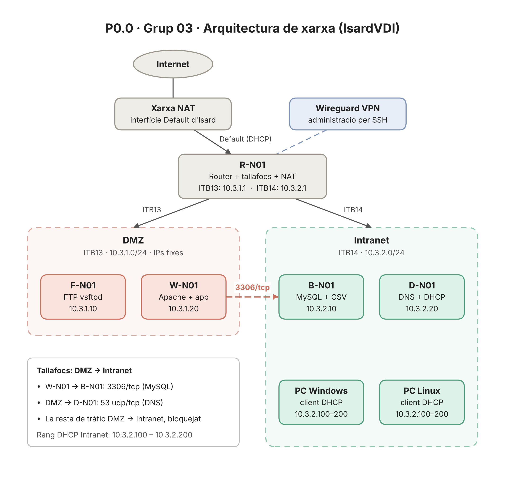

# Xarxa: pla d'adreçament i diagrama
 
## Xarxes d'IsardVDI
 
| Interfície d'Isard | Ús | Subxarxa |
|---|---|---|
| Default | NAT: sortida a Internet | DHCP d'Isard |
| ASIXC2-ITB13 | DMZ | 10.3.1.0/24 |
| ASIXC2-ITB14 | Intranet | 10.3.2.0/24 |
| ITB13a / ITB14a | Reserva | — |
| Wireguard VPN | Accés d'administració des de fora | VPN d'Isard |

## Diagrama d'arquitectura
 

 
*Arquitectura de xarxa del grup 03. Les úniques connexions permeses de la DMZ cap a la Intranet són W-N01 → B-N01 pel port 3306/tcp i la DMZ → D-N01 pel port 53 (DNS).*
 
 
## Pla d'adreçament
 
| Equip | Funció | Interfícies | IP | Gateway | DNS |
|---|---|---|---|---|---|
| R-N01 | Router, tallafocs i NAT | Default, ITB13, ITB14, VPN | DHCP / 10.3.1.1 / 10.3.2.1 / VPN | Default | 	El d'Isard, rebut per DHCP de la Default |
| F-N01 | FTP (vsftpd) | ITB13 | 10.3.1.10 | 10.3.1.1 | 10.3.2.20 |
| W-N01 | Web (Apache + app) | ITB13, VPN | 10.3.1.20 | 10.3.1.1 | 10.3.2.20 |
| B-N01 | BBDD (MySQL) | ITB14 | 10.3.2.10 | 10.3.2.1 | 10.3.2.20 |
| D-N01 | DNS + DHCP | ITB14 | 10.3.2.20 | 10.3.2.1 | 127.0.0.1 |
| PC Windows | Client | ITB14 | DHCP | DHCP | DHCP |
| PC Linux | Client | ITB14 | DHCP | DHCP | DHCP |
 
- **Rang DHCP (Intranet):** 10.3.2.100 – 10.3.2.200
- **Reservades per a futures màquines:** 10.3.1.2–9 (DMZ) i 10.3.2.2–9 (Intranet)
- **Registres DNS:** R-N01 → 10.3.2.1; R → àlies de R-N01; F-N01, W-N01, B-N01 i D-N01 amb la seva IP.

### Criteri d'adreçament
 
Les adreces segueixen el format `10.3.X.H`:
 
- **3:** número de grup, perquè les adreces no coincideixin amb les d'altres grups.
- **X:** la xarxa (1 DMZ, 2 Intranet). Només amb veure una IP se sap on és l'equip.
- **H:** `.1` per al router, `.2` a `.9` reservades, `.10` i `.20` per als servidors i `.100` a `.200` per als clients.

## Justificació del disseny

### Tres xarxes separades

La infraestructura es divideix segons qui ha de poder accedir a cada servei:

| Xarxa | Funció | Equips |
|---|---|---|
| NAT | Connexió amb l'exterior | Només R-N01 |
| DMZ | Serveis que s'ofereixen cap a fora | F-N01, W-N01 |
| Intranet | Serveis i equips interns, no exposats | B-N01, D-N01, clients |

Si un servei de la DMZ queda compromès, l'atacant no té accés directe a la Intranet, per arribar-hi ha de passar pel router, que només deixa passar el trànsit imprescindible.

### Decisions sobre la DMZ (web i FTP)

Són els serveis pensats per ser consultats des de fora de l'organització. Tenir-los en una xarxa pròpia permet exposar-los sense exposar també la xarxa interna.

### Decisions relatives a la base de dades

Les dades són el més valuós i no s'han de poder consultar des de fora. L'aplicació de W-N01 les necessita, però no cal que siguin a la mateixa xarxa es connecta a través del router, només pel port 3306/tcp. Si algú comprometés el servidor web, no podria accedir a la base de dades.

### Decisions relatives a DHCP i DNS

- **DHCP:** Funciona per difusió (*broadcast*). El client, que encara no té IP, envia la petició a tota la seva xarxa, i aquests missatges no travessen el router. Per això el servidor ha d'estar al mateix segment que els clients.
- **DNS:** És un servei intern, que tradueix els noms dels nostres equips. Els servidors de la DMZ també el fan servir, i per això el tallafocs permet el port 53 de la DMZ cap a D-N01. És l'única excepció, a més de la base de dades.

### Decisions relatives al router

Tot el trànsit entre xarxes, i cap a Internet, passa per R-N01. Això el converteix en l'únic punt on cal controlar què pot anar d'una xarxa a l'altra, fa el NAT perquè la DMZ i la Intranet surtin a Internet i aplica el tallafocs. Cap altre equip té interfície a la xarxa NAT.

### Decisions relatives a la VPN

La VPN permet administrar la infraestructura per SSH des de fora del centre. El punt d'entrada previst és el router: entrar per R-N01, en lloc de connectar cada màquina a la VPN, manté un únic punt d'entrada i fa que aquest accés també quedi sota el control del tallafocs.

W-N01 també té un adaptador a la VPN. L'accés per aquest adaptador no passa pel router ni pel seu tallafocs, i la ruta que afegeix la VPN va obligar a configurar una ruta explícita a la Intranet (vegeu la nota sobre la VPN al final del document).

### IP fixa als servidors i DHCP als clients

Els servidors han de tenir sempre la mateixa adreça perquè els altres equips els trobin i perquè les regles del tallafocs siguin persistents. Els clients poden canviar d'adreça sense problema, i el DHCP evita configurar-los un a un.

### Agrupació de serveis per màquina

El criteri general és **un servei principal per màquina**:

- **Aïllament:** si un servei falla, s'ha de reiniciar o queda compromès, la resta continua funcionant.
- **Manteniment:** es pot actualitzar o reconfigurar una màquina sense aturar d'altres.
- **Seguretat:** cada màquina té només el programari que necessita, de manera que hi ha menys punts vulnerables.

Les excepcions següents tenen el seu motiu:

**DNS i DHCP a la mateixa màquina (D-N01).** Són dos serveis d'infraestructura petits i molt lligats:

- El DHCP, a més de la IP, diu a cada client quin servidor DNS ha de fer servir, tots dos formen part de la configuració de xarxa que reben els equips.
- Tots dos han de ser a la Intranet i consumeixen molt pocs recursos. Separar-los només duplicaria màquines sense cap avantatge.
- Si més endavant es vol que el DNS registri automàticament el nom dels clients quan el DHCP els dona IP (DNS dinàmic), tenir-los a la mateixa màquina ho simplifica. Ara no està configurat: els clients no tenen registre al DNS.

L'inconvenient és que D-N01 és un punt únic de fallada: si cau, els clients nous no reben IP i no es resolen noms.

**Apache i l'aplicació a la mateixa màquina (W-N01).** No són dos serveis independents, l'aplicació és codi PHP que executa Apache. Apache rep la petició, PHP genera la pàgina i Apache la retorna. L'aplicació no funciona sense el servidor web, i separar-los no tindria sentit.

El que sí que se separa de l'aplicació és la **base de dades**, perquè té un altre nivell de seguretat i és a una altra xarxa.

**El web i l'FTP en màquines diferents (W-N01 i F-N01).** Tots dos són a la DMZ, però són serveis independents. A més, l'FTP envia usuaris i contrasenyes sense xifrar, i és un dels serveis més atacats. Tenir-lo en una màquina pròpia fa que, si queda compromès, el servidor web no se'n vegi afectat.

**El router no fa cap altre servei (R-N01).** Tot el trànsit hi passa, així que és la peça més crítica de la xarxa. No s'hi instal·la res més perquè tingui els mínims punts vulnerables possibles i perquè un error en un altre servei no deixi tota la infraestructura sense xarxa.

## Tecnologies escollides

Per a cada servei s'han valorat les alternatives principals. Els criteris han estat quatre: que funcioni amb la plantilla Ubuntu Server d'IsardVDI, que tingui suport i actualitzacions, que estigui ben documentat i que sigui adequat a la mida del projecte.

| Àmbit | Triat | Alternatives valorades | Motiu de l'elecció |
|---|---|---|---|
| Virtualització | IsardVDI | — | Imposat pel centre. Proporciona les xarxes ITB13 i ITB14 i les plantilles |
| Sistema operatiu dels servidors | Ubuntu Server 24.04 LTS | Debian 12, Rocky Linux | És la plantilla d'Isard. Versió LTS, amb suport estàndard fins al maig de 2029 i manteniment ampliat fins al 2034. Sense entorn gràfic, consumeix pocs recursos |
| Configuració de xarxa | netplan | `ifupdown` (`/etc/network/interfaces`), NetworkManager | És el sistema per defecte d'Ubuntu Server. Un sol fitxer YAML per màquina, fàcil de llegir i de guardar al repositori |
| Router, NAT i tallafocs | `iptables` amb `iptables-persistent` | `ufw`, `nftables`, una distribució de router (pfSense, OPNsense) | `ufw` és l'eina per defecte d'Ubuntu, però està pensada per a tallafocs d'un sol equip, no per filtrar el trànsit entre xarxes ni fer NAT. `iptables` controla directament les cadenes `FORWARD` i `POSTROUTING` amb poques regles. Una distribució de router afegiria un sistema diferent, fora de la plantilla comuna |
| DNS | BIND9 | dnsmasq, Unbound | És el servidor DNS que inclou i documenta Ubuntu Server. Permet zones directa i inversa i reenviament a un DNS públic en un sol servei. dnsmasq és més senzill, però té menys control sobre les zones. Unbound només fa de resolutor, no d'autoritat |
| DHCP | `isc-dhcp-server` | Kea, dnsmasq | Configuració en un sol fitxer i àmpliament documentada. **Inconvenient:** ISC el va deixar de mantenir l'octubre de 2022, i Ubuntu el considera obsolet i sense suport des de la 24.04. Tots dos recomanen Kea. Per a un entorn de pràctiques aïllat és acceptable, però en producció caldria migrar a Kea |
| Base de dades | MySQL 8.0 | MariaDB, PostgreSQL | És la versió dels repositoris d'Ubuntu 24.04, i PHP s'hi connecta amb `pdo_mysql`. **Inconvenient:** Oracle va acabar el suport de la branca 8.0 l'abril de 2026. Caldria planificar el pas a la 8.4 |
| Servidor web | Apache 2.4 amb PHP 8.3 (`mod_php`) | Nginx amb PHP-FPM | Apache executa PHP directament amb `libapache2-mod-php`, sense un servei addicional. Nginx rendeix millor amb molta concurrència, però per al volum del projecte no cal: la pàgina respon en uns 0,04 s |
| FTP | vsftpd | ProFTPD, SFTP (OpenSSH) | Lleuger i pensat per ser segur, amb engabiament (*chroot*) dels usuaris senzill de configurar. SFTP xifraria les credencials, però l'enunciat demana un servidor FTP |
| Control de versions | Git i GitHub | GitLab | Demanat per l'enunciat. GitHub permet validar el servidor web amb una clau de desplegament |
| Gestió de tasques | ProofHub | Trello, Jira | Demanat per l'enunciat |

## Tallafocs

| Origen | Destí | Permès | Motiu |
|---|---|---|---|
| Intranet (10.3.2.0/24) | Internet | Tot | Actualitzacions i navegació dels clients |
| DMZ (10.3.1.0/24) | Internet | Tot | Actualitzacions dels servidors (`apt`) |
| Intranet (10.3.2.0/24) | DMZ | Tot | Els equips interns fan servir el web i l'FTP |
| W-N01 (10.3.1.20) | B-N01 (10.3.2.10) | 3306/tcp | L'aplicació web llegeix la base de dades |
| DMZ (10.3.1.0/24) | D-N01 (10.3.2.20) | 53 udp/tcp | Resolució de noms |
| Resta de la DMZ | Intranet | Bloquejat | Aïllament de la xarxa interna |

## Nota sobre la VPN

La VPN d'Isard afegeix una ruta `10.0.0.0/14`, que inclou els rangs 10.3.x.x. Un paquet sempre segueix la ruta més específica que el cobreix:

- **A R-N01** no hi ha problema. Té connectades directament les dues subxarxes internes (`10.3.1.0/24` i `10.3.2.0/24`), que són més específiques que la `/14`, i el trànsit intern no surt mai per la VPN.
- **A W-N01** sí que n'hi havia. Només té connectada la DMZ. Per arribar a la Intranet (10.3.2.x), la ruta `/14` de la VPN era més específica que la ruta per defecte, i les respostes a la Intranet sortien per la VPN i es perdien. Es va detectar durant les proves finals (B-N01 no podia fer ping a W-N01) i es va solucionar amb la ruta explícita `10.3.2.0/24 via 10.3.1.1`.

Per tant, qualsevol màquina de la DMZ o la Intranet que tingui adaptador VPN necessita una ruta explícita cap a l'altra xarxa interna a través del router.
