# R-N01 – Router

R-N01 és el router de la infraestructura. Connecta la DMZ i la Intranet entre elles i amb Internet, fa NAT perquè les màquines internes puguin sortir a l'exterior, i fa de tallafocs entre les dues xarxes. És la primera màquina que es desplega, perquè la resta depenen d'ella per tenir connectivitat.

## 1. Creació de la màquina

La màquina s'ha creat a IsardVDI a partir de la plantilla **Ubuntu Server 24.04**. S'ha triat Ubuntu Server perquè no té entorn gràfic, i per tant consumeix pocs recursos i redueix la superfície d'atac. A més, la versió 24.04 és LTS i rep actualitzacions de seguretat fins al 2029.

| Paràmetre | Valor | Justificació |
|---|---|---|
| vCPUs | 2 | L'encaminament i el NAT consumeixen molt poca CPU |
| Memòria | 2 GB | Suficient per a Ubuntu Server sense entorn gràfic |
| Disc | Hard Disk (per defecte) | El de la plantilla |

### Adaptadors de xarxa

El router és l'única màquina que té una interfície a cada xarxa, perquè és qui ha de passar el trànsit d'una a l'altra.

| Adaptador | Xarxa d'Isard | MAC | Interfície | Ús |
|---|---|---|---|---|
| 1 | Default | 52:54:00:06:1c:58 | `enp1s0` | Sortida a Internet. Rep la IP per DHCP de la xarxa NAT d'Isard |
| 2 | ASIXC2-ITB13 | 52:54:00:2b:f7:20 | `enp2s0` | DMZ. Gateway dels servidors exposats, IP 10.3.1.1/24 |
| 3 | ASIXC2-ITB14 | 52:54:00:3f:fe:83 | `enp3s0` | Intranet. Gateway de les màquines internes, IP 10.3.2.1/24 |
| 4 | Wireguard VPN | 52:54:00:64:a3:b4 | `enp4s0` | Accés d'administració per SSH des de fora d'Isard |

S'han apuntat les adreces MAC perquè dins del sistema les interfícies es diuen `enp1s0`, `enp2s0`, etc. Comparant les MAC és l'única manera segura de saber quina interfície correspon a cada xarxa abans de configurar les IPs.

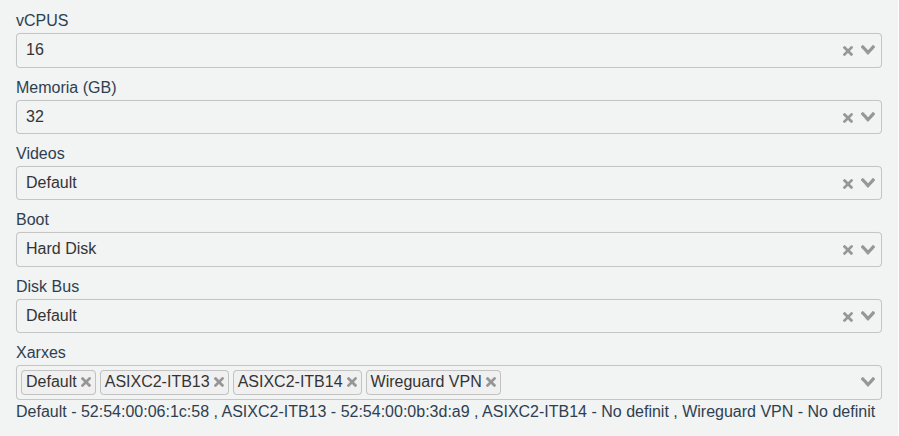

*Configuració de recursos i xarxes de l'escriptori R-N01 a IsardVDI.*

## 2. Configuració base

Aquesta configuració s'aplica igual a totes les màquines del projecte. Així totes queden homogènies i compleixen el requisit de l'usuari bchecker.

### 2.1 Nom de la màquina i usuari bchecker

```bash
sudo hostnamectl set-hostname R-N01
sudo adduser bchecker
sudo usermod -aG sudo bchecker
```

- **`hostnamectl set-hostname`** canvia el nom de la màquina de forma persistent. El nom segueix la nomenclatura del projecte i és el que després resoldrà el DNS. El prompt no canvia fins que es torna a iniciar sessió, per això a la captura encara es veu `ubuntu2404`.
- **`adduser bchecker`** crea l'usuari amb el seu directori personal i li assigna la contrasenya que es comunica al professor per separat. Els camps d'informació personal s'han deixat en blanc perquè no són necessaris. L'enunciat exigeix aquest usuari a tots els sistemes, per a la correcció.
- **`usermod -aG sudo bchecker`** afegeix l'usuari al grup `sudo`, perquè pugui administrar la màquina. L'opció `-a` (*append*) és important: sense ella, l'usuari perdria la resta de grups als quals pertany.

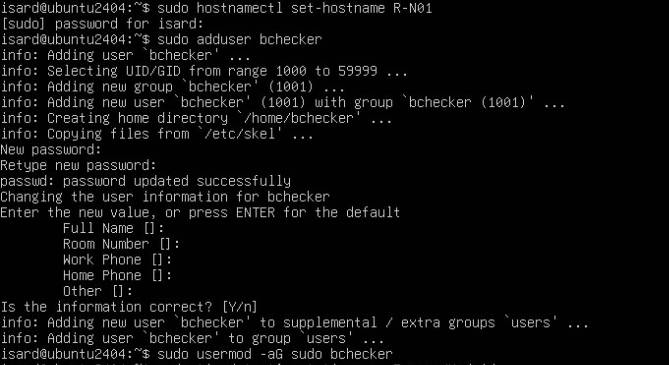

*Canvi de hostname i creació de l'usuari bchecker.*

### 2.2 Zona horària i actualització del sistema

```bash
sudo timedatectl set-timezone Europe/Madrid
sudo apt update && sudo apt upgrade -y
```

- **Zona horària Europe/Madrid:** els logs del sistema i dels serveis han de tenir l'hora local. Si no, és difícil relacionar-los amb les proves i les captures, i en un context de seguretat és clau saber exactament quan ha passat cada cosa.
- **`apt update`** actualitza la llista de paquets disponibles, i **`apt upgrade -y`** instal·la les actualitzacions pendents. Es fa abans de configurar cap servei, perquè la plantilla pot tenir paquets antics amb vulnerabilitats conegudes. Durant l'actualització, el sistema ha demanat el joc de caràcters de la consola i s'ha triat *Latin1 and Latin5*, que és el que suporta els accents del català i del castellà. 

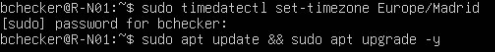

*Configuració de la zona horària i actualització del sistema.*

### 2.3 Accés SSH

```bash
sudo apt install -y openssh-server
sudo systemctl enable --now ssh
```

- El paquet `openssh-server` ja venia instal·lat a la plantilla, com indica el missatge *"already the newest version"*. Tot i així, s'executa l'ordre per assegurar-ho.
- **`systemctl enable --now ssh`** arrenca el servei immediatament (`--now`) i el deixa activat perquè arrenqui sol en cada reinici (`enable`). Això és el que permet administrar el router en remot, i el que permetrà al professor entrar-hi amb l'usuari bchecker.

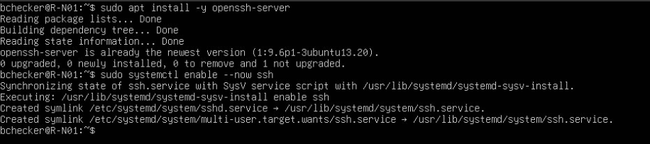

*Instal·lació i activació del servei SSH.*

### 2.4 Configuració de xarxa (netplan)

**Què fa.** Assigna a cada interfície la seva xarxa: la Default obté IP per DHCP d'Isard i és la sortida a Internet, mentre que ITB13 (DMZ) i ITB14 (Intranet) reben una IP fixa, que fa de *gateway* de cada xarxa. La VPN també obté IP per DHCP, però amb una mètrica més alta perquè la ruta per defecte continuï sortint per la Default.

**Configuració.** Fitxer `/etc/netplan/50-cloud-init.yaml`. Abans, s'ha desactivat la configuració de xarxa de cloud-init perquè no el sobreescrigui en reiniciar.

```yaml
network:
  version: 2
  ethernets:
    enp1s0:
      dhcp4: true
    enp2s0:
      addresses: [10.3.1.1/24]
    enp3s0:
      addresses: [10.3.2.1/24]
    enp4s0:
      dhcp4: true
      dhcp4-overrides:
        route-metric: 200
        use-dns: false
```

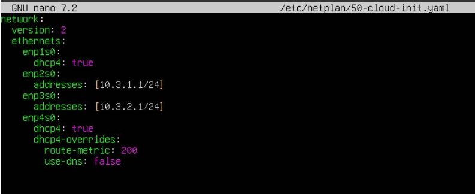

*Fitxer de configuració de netplan editat amb nano.*

### 2.5 Comprovació

```bash
hostnamectl | grep hostname
id bchecker
timedatectl | grep "Time zone"
systemctl status ssh
ip -br a
ip route
```

| Comprovació | Resultat obtingut |
|---|---|
| Hostname | `Static hostname: R-N01` |
| Usuari bchecker | uid 1001, inclòs al grup `27(sudo)` |
| Zona horària | `Europe/Madrid (CEST, +0200)` |
| Servei SSH | `active (running)` i `enabled` |
| Netplan | Ip's de les interfícies i taula d'enrutament |

A més, aquestes comprovacions ja s'han fet havent iniciat sessió com a **bchecker** (el prompt mostra `bchecker@R-N01`). Això demostra que l'usuari funciona i que pot fer servir `sudo`.

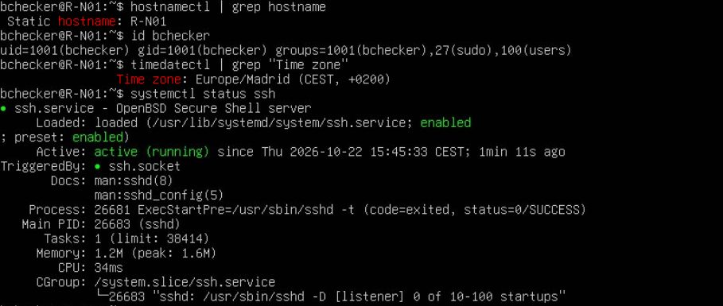
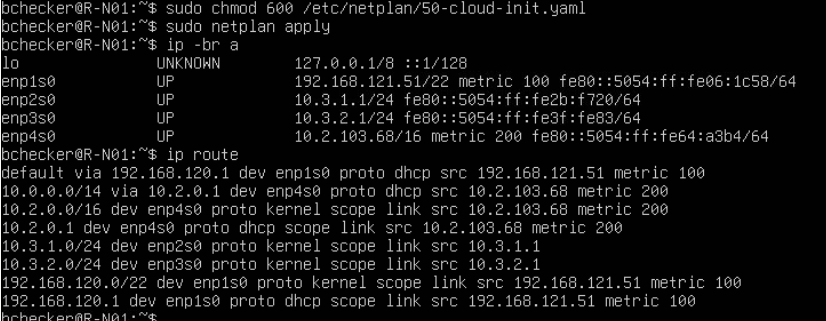

*Comprovació final de la configuració base.*

## 3. Serveis

### 3.1 Reenviament de paquets (IP forwarding)

**Què fa.** Permet al router passar paquets d'una xarxa a l'altra. Sense aquest reenviament, R-N01 només respondria per a ell mateix, i les màquines de la DMZ i la Intranet no es veurien.

**Configuració.** Fitxer `/etc/sysctl.d/99-router.conf` amb la línia `net.ipv4.ip_forward=1`. El fitxer ha de tenir l'extensió `.conf`, perquè `sysctl --system` només llegeix aquest tipus de fitxer.

```bash
echo "net.ipv4.ip_forward=1" | sudo tee /etc/sysctl.d/99-router.conf
sudo sysctl --system
```

**Comprovació.** Després d'aplicar-ho amb `sudo sysctl --system`, `sysctl net.ipv4.ip_forward` ha de mostrar `= 1`.

```bash
sysctl net.ipv4.ip_forward
```

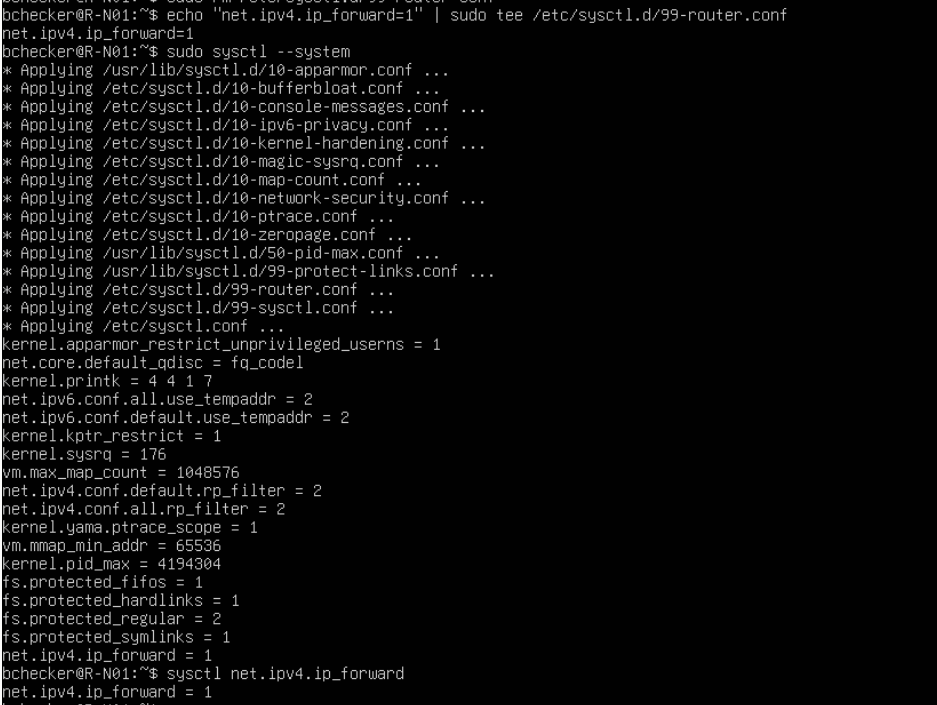

*Aplicació del reenviament de paquets i valor de `net.ipv4.ip_forward`.*

### 3.2 NAT (MASQUERADE)

**Què fa.** Permet que les màquines de la DMZ i la Intranet surtin a Internet. Les seves IPs són privades (10.3.x.x) i Internet no sap tornar-hi, així que el router canvia l'origen dels paquets per la seva pròpia IP de la Default. Les respostes tornen al router i ell les reenvia a la màquina que les ha demanat.

**Configuració.** Una regla a la taula `nat`, cadena `POSTROUTING`, que aplica a les màquines internes amb sortida per la Default:

```bash
sudo iptables -t nat -A POSTROUTING -s 10.3.0.0/16 -o enp1s0 -j MASQUERADE
```

La regla es fa persistent amb `iptables-persistent`, perquè sobrevisqui a un reinici:

```bash
sudo apt install -y iptables iptables-persistent
sudo netfilter-persistent save
```

**Comprovació.** Des d'una màquina interna amb la ruta per defecte via el router (en aquest cas W-N01), es fa `ping -c 3 8.8.8.8`. Després, al router, el comptador de la regla ha de ser superior a 0.

```bash
sudo iptables -t nat -L POSTROUTING -n -v
```

Durant la configuració, el comptador es va mantenir a 0 mentre W-N01 tenia encara la ruta per defecte per la interfície Default. Això va passar perquè el trànsit no arribava al router. Quan la ruta va passar a ser via `10.3.1.1`, el NAT va començar a funcionar. Es van fer diversos pings per comprovar com el comptador pujava; en aquest cas el número és 6, perquè s'han realitzat 6 pings.

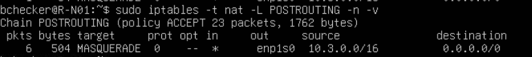

*Comptador de la regla MASQUERADE després dels pings a 8.8.8.8 des de W-N01.*

### 3.3 Tallafocs

**Què fa.** Controla el trànsit que travessa el router entre la DMZ i la Intranet. La DMZ conté els servidors exposats, i per tant és la zona amb més risc de ser atacada. Si un atacant comprometés una màquina de la DMZ, el tallafocs li impediria arribar a la Intranet, excepte pels dos serveis imprescindibles:

| Origen | Destí | Port | Acció | Motiu |
|---|---|---|---|---|
| W-N01 (10.3.1.20) | B-N01 (10.3.2.10) | 3306/tcp | Permès | L'aplicació web consulta MySQL |
| DMZ (10.3.1.0/24) | D-N01 (10.3.2.20) | 53/udp i 53/tcp | Permès | Les màquines de la DMZ fan servir el DNS |
| DMZ (10.3.1.0/24) | Intranet (10.3.2.0/24) | Qualsevol altre | Bloquejat | Aïllar la Intranet de la zona exposada |
| Intranet | DMZ i Internet | Qualsevol | Permès | Els clients han d'accedir a la web i a l'FTP |

**Configuració.** Les regles s'afegeixen a la cadena `FORWARD` de la taula `filter`, que és la que s'aplica als paquets que travessen el router. No es toca la cadena `INPUT`, de manera que l'accés per SSH al mateix router no es veu afectat. L'ordre és important, perquè iptables avalua les regles de dalt a baix i aplica la primera que coincideix:

```bash
sudo iptables -A FORWARD -m conntrack --ctstate ESTABLISHED,RELATED -j ACCEPT
sudo iptables -A FORWARD -s 10.3.1.20 -d 10.3.2.10 -p tcp --dport 3306 -j ACCEPT
sudo iptables -A FORWARD -s 10.3.1.0/24 -d 10.3.2.20 -p udp --dport 53 -j ACCEPT
sudo iptables -A FORWARD -s 10.3.1.0/24 -d 10.3.2.20 -p tcp --dport 53 -j ACCEPT
sudo iptables -A FORWARD -s 10.3.1.0/24 -d 10.3.2.0/24 -j DROP
```

1. **ESTABLISHED,RELATED:** deixa passar les respostes de les connexions ja permeses. Per exemple, quan un client de la Intranet obre la web de W-N01, la resposta va de la DMZ a la Intranet, i sense aquesta regla la bloquejaria l'última.
2. **W-N01 → B-N01, 3306/tcp:** només el servidor web, i no tota la DMZ, pot connectar-se a MySQL.
3. **DMZ → D-N01, 53/udp:** consultes DNS normals.
4. **DMZ → D-N01, 53/tcp:** el DNS fa servir TCP per a les respostes grans.
5. **DMZ → Intranet, DROP:** la resta del trànsit de la DMZ cap a la Intranet es descarta. S'ha triat `DROP` i no `REJECT` perquè no doni cap resposta a l'origen, i així un possible atacant no sap si hi ha màquines darrere.

El trànsit que no coincideix amb cap regla (de la Intranet cap a la DMZ, i de les dues xarxes cap a Internet) segueix la política per defecte de la cadena, `ACCEPT`, i el NAT de l'apartat 3.2 continua funcionant igual.

Les regles es fan persistents amb `netfilter-persistent`, igual que la del NAT:

```bash
sudo netfilter-persistent save
```

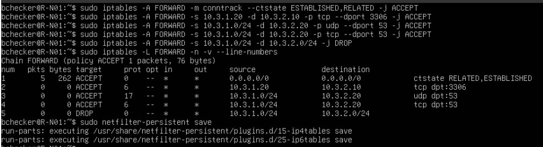

*Creació de les regles del tallafocs, llistat de la cadena FORWARD i desat persistent.*

**Comprovació.** Les proves es fan des de les màquines de la DMZ i de la Intranet, no des del router: el trànsit que surt del mateix R-N01 passa per la cadena `OUTPUT` i no per `FORWARD`, i per tant no passaria pel tallafocs.

Des de F-N01, que no ha de poder arribar a la Intranet excepte al DNS:

```bash
ping -c 2 -W 2 10.3.2.10
nc -zv -w 3 10.3.2.10 3306
dig @10.3.2.20 B-N01.g03.intra +short
```

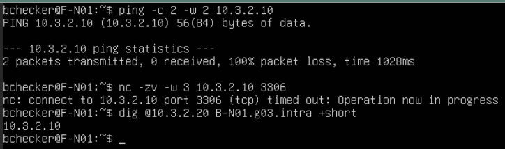

*Proves des de F-N01: ping i MySQL bloquejats, DNS permès.*

Des de W-N01, que només ha de poder arribar a B-N01 pel port 3306:

```bash
nc -zv -w 3 10.3.2.10 3306
ping -c 2 -W 2 10.3.2.10
```

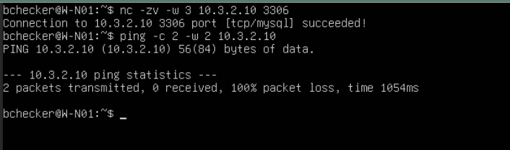

*Proves des de W-N01: connexió a MySQL permesa, ping bloquejat.*

Des d'un client de la Intranet, que ha de poder arribar a la DMZ:

```bash
ping -c 2 10.3.1.20
```

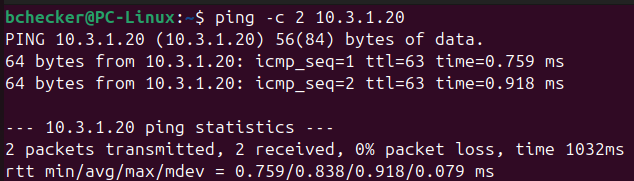

*Prova des de PC-Linux cap a W-N01.*

| Prova | Resultat obtingut | Esperat |
|---|---|---|
| F-N01 → B-N01 (ping) | 100% packet loss | Bloquejat |
| F-N01 → B-N01:3306 | `timed out` | Bloquejat |
| F-N01 → D-N01:53 (`dig`) | `10.3.2.10` | Permès |
| W-N01 → B-N01:3306 | `succeeded` | Permès |
| W-N01 → B-N01 (ping) | 100% packet loss | Bloquejat |
| PC-Linux → W-N01 (ping) | Respon, `ttl=63` | Permès |

El `ttl=63` del client indica que el paquet ha travessat un encaminador, el router, que li ha restat 1 al valor inicial de 64.

Finalment, al router, els comptadors de cada regla confirmen per on ha passat el trànsit de les proves:

```bash
sudo iptables -L FORWARD -n -v --line-numbers
```

| Regla | Paquets | Interpretació |
|---|---|---|
| 1. ESTABLISHED,RELATED | 5396 | Respostes de totes les connexions permeses |
| 2. W-N01 → B-N01:3306 | 1 | El `nc` de W-N01 |
| 3. DMZ → D-N01:53/udp | 2 | El `dig` de F-N01 |
| 4. DMZ → D-N01:53/tcp | 0 | Cap, perquè el `dig` ha fet servir UDP |
| 5. DMZ → Intranet DROP | 12 | Els pings i el `nc` bloquejats |

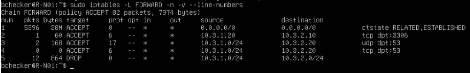

*Comptadors de les regles de la cadena FORWARD després de les proves.*
