# D-N01 – DNS i DHCP

D-N01 és el servidor de noms i de configuració de xarxa de la Intranet. Ofereix el servei DHCP perquè els clients rebin IP, gateway i DNS de manera automàtica, i el servei DNS perquè totes les màquines es resolguin pel nom. Té una única interfície, a ITB14, perquè és una màquina de la Intranet.

## 1. Creació de la màquina

La màquina s'ha creat a IsardVDI a partir de la plantilla **Ubuntu Server 24.04**, com la resta de servidors del projecte. Té una sola interfície perquè només ha de treballar dins de la Intranet.

| Paràmetre | Valor | Justificació |
|---|---|---|
| vCPUs | 2 | El DNS i el DHCP consumeixen molt poca CPU |
| Memòria | 2 GB | Suficient per a Ubuntu Server sense entorn gràfic |
| Disc | Hard Disk (per defecte) | El de la plantilla |

### Adaptadors de xarxa

El servidor només té un adaptador, a la Intranet. No té la interfície Default, perquè la sortida a Internet la fa el router: els paquets de D-N01 surten pel gateway 10.3.2.1 i el NAT de R-N01 els deixa sortir.

| Adaptador | Xarxa d'Isard | MAC | Interfície | Ús |
|---|---|---|---|---|
| 1 | ASIXC2-ITB14 | 52:54:00:59:34:2a | `enp1s0` | Intranet. IP fixa 10.3.2.20/24, gateway 10.3.2.1 |


*Configuració de recursos i xarxes de l'escriptori D-N01 a IsardVDI.*

## 2. Configuració base

Aquesta configuració s'aplica igual a totes les màquines del projecte. Així totes queden homogènies i compleixen el requisit de l'usuari bchecker.

### 2.1 Nom de la màquina i usuari bchecker

```bash
sudo hostnamectl set-hostname D-N01
sudo adduser bchecker
sudo usermod -aG sudo bchecker
```

- **`hostnamectl set-hostname`** canvia el nom de la màquina de forma persistent. És el nom que el DNS ha de resoldre i el que els clients veuran a la xarxa.
- **`adduser bchecker`** crea l'usuari amb el seu directori personal i li assigna la contrasenya `bchecker121`. Els camps d'informació personal s'han deixat en blanc perquè no són necessaris. L'enunciat exigeix aquest usuari a tots els sistemes, per a la correcció.
- **`usermod -aG sudo bchecker`** afegeix l'usuari al grup `sudo`, perquè pugui administrar la màquina. L'opció `-a` (*append*) és important: sense ella, l'usuari perdria la resta de grups als quals pertany.

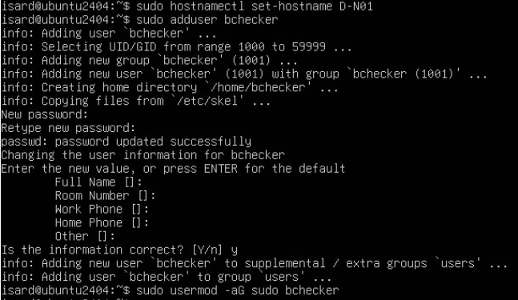

*Canvi de hostname i creació de l'usuari bchecker.*

### 2.2 Zona horària i actualització del sistema

```bash
sudo timedatectl set-timezone Europe/Madrid
sudo apt update && sudo apt upgrade -y
```

- **Zona horària Europe/Madrid:** els logs del DNS i del DHCP han de tenir l'hora local. Si no, és difícil relacionar-los amb les proves i les captures dels clients.
- **`apt update`** actualitza la llista de paquets disponibles, i **`apt upgrade -y`** instal·la les actualitzacions pendents. Es fa abans d'instal·lar bind9 i el servidor DHCP, perquè la plantilla pot tenir paquets antics amb vulnerabilitats conegudes. Durant l'actualització, el sistema ha demanat el joc de caràcters de la consola i s'ha triat *Latin1 and Latin5*, que és el que suporta els accents del català i del castellà.


*Configuració de la zona horària i actualització del sistema.*

### 2.3 Accés SSH

```bash
sudo apt install -y openssh-server
sudo systemctl enable --now ssh
```

- El paquet `openssh-server` ja venia instal·lat a la plantilla, com indica el missatge *"already the newest version"*. Tot i així, s'executa l'ordre per assegurar-ho.
- **`systemctl enable --now ssh`** arrenca el servei immediatament (`--now`) i el deixa activat perquè arrenqui sol en cada reinici (`enable`). Això permet administrar D-N01 en remot, i el professor hi pot entrar amb l'usuari bchecker.


*Instal·lació i activació del servei SSH.*

### 2.4 Configuració de xarxa (netplan)

**Què fa.** Assigna a l'única interfície la IP fixa de la Intranet i el gateway del router, perquè la màquina surti a Internet a través de R-N01. Com que no té DHCP, el DNS s'indica de manera temporal (8.8.8.8) fins que D-N01 estigui operatiu.

**Configuració.** Fitxer `/etc/netplan/50-cloud-init.yaml`. Abans, s'ha desactivat la configuració de xarxa de cloud-init perquè no el sobreescrigui en reiniciar.

```yaml
network:
  version: 2
  ethernets:
    enp1s0:                        # ASIXC2-ITB14: Intranet
      addresses: [10.3.2.20/24]
      routes:
        - to: default
          via: 10.3.2.1
      nameservers:
        addresses: [8.8.8.8]       # temporal, fins que D-N01 resolgui
```


*Fitxer de configuració de netplan editat amb nano.*

### 2.5 Comprovació

```bash
hostnamectl | grep hostname
id bchecker
timedatectl | grep "Time zone"
systemctl status ssh
ip -br a
ip route
ping -c 3 8.8.8.8
```

| Comprovació | Resultat obtingut |
|---|---|
| Hostname | `Static hostname: D-N01` |
| Usuari bchecker | Inclòs al grup `27(sudo)` |
| Zona horària | `Europe/Madrid (CEST, +0200)` |
| Servei SSH | `active (running)` i `enabled` |
| Netplan | IP de `enp1s0` (10.3.2.20/24) i ruta per defecte via 10.3.2.1 |
| Sortida a Internet | `ping` a 8.8.8.8 respon, passant pel router |

A més, aquestes comprovacions ja s'han fet havent iniciat sessió com a **bchecker** (el prompt mostra `bchecker@D-N01`). Això demostra que l'usuari funciona i que pot fer servir `sudo`.

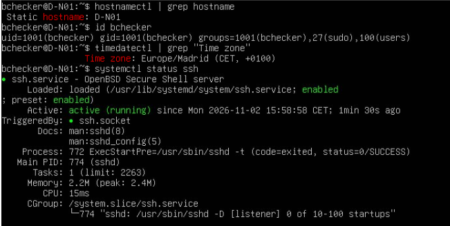


*Comprovació final de la configuració base i de la xarxa.*

## 3. Serveis

### 3.1 Servidor DHCP

**Què fa.** Assigna automàticament la configuració de xarxa als clients de la Intranet: IP dins del rang 10.3.2.100–200, gateway 10.3.2.1 i DNS 10.3.2.20. Així els clients no necessiten configuració manual, i la configuració és la mateixa per a tothom.

**Configuració.** El servei només escolta a enp1s0 (la interfície de la Intranet), perquè no ofereixi IPs a la DMZ, que va amb IP fixa. Això s'indica al fitxer /etc/default/isc-dhcp-server:

```bash
INTERFACESv4="enp1s0"
```
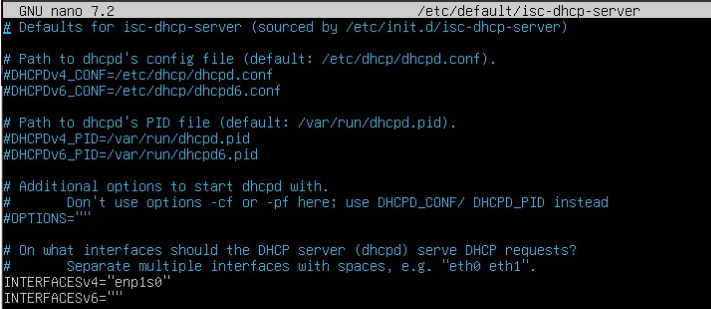

*Fitxer de configuració d'interfície*

El rang i les opcions es defineixen al fitxer /etc/dhcp/dhcpd.conf:

```bash
authoritative;

subnet 10.3.2.0 netmask 255.255.255.0 {
    range 10.3.2.100 10.3.2.200;
    option routers 10.3.2.1;
    option domain-name-servers 10.3.2.20;
    option domain-name "g03.intra";
    default-lease-time 600;
    max-lease-time 7200;
}
```
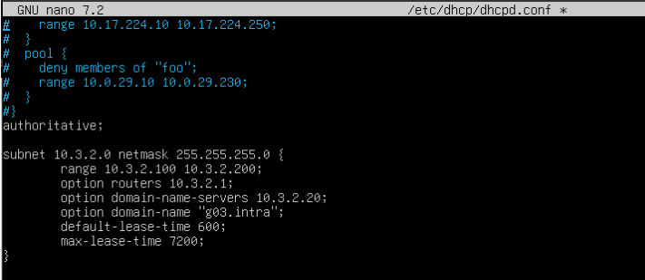

*Fitxer de configuració dhcpd.conf*

El domini és g03.intra i no g03.local, perquè .local està reservat per a mDNS i pot donar problemes de resolució.

Després d'editar el fitxer, es comprova la sintaxi i s'arrenca el servei:

```bash
sudo dhcpd -t -cf /etc/dhcp/dhcpd.conf
sudo systemctl enable --now isc-dhcp-server
```
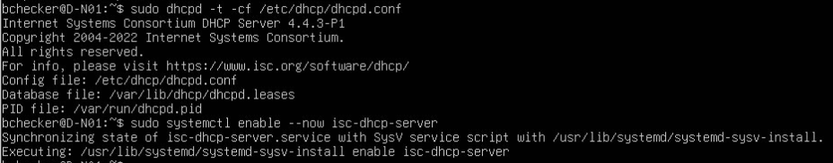

*Comprovació de la sintaxi i arrencada del servei*

**Comprovació.** La sortida de systemctl status ha de mostrar active (running), i el servei ha d'escoltar a enp1s0, dins de 10.3.2.0/24.

```bash
systemctl status isc-dhcp-server
```

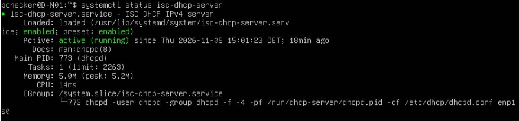

*Estat del servei DHCP a D-N01 i interfície on escolta.*

### 3.2 Servidor DNS (bind9)

**Què fa.** Tradueix els noms de les màquines del projecte a IP, i són els clients els que li demanen. Té una zona directa (g03.intra, de nom a IP) i dues zones inverses (de IP a nom), una per a la DMZ i una per a la Intranet. Les consultes de noms externs (per exemple, google.com) es reenvien al DNS públic 8.8.8.8, perquè les màquines internes puguin navegar.

**Configuració.** S'instal·la bind9 i es defineixen les opcions generals, les zones i els registres.

```bash
sudo apt update
sudo apt install -y bind9 bind9utils dnsutils
sudo systemctl status bind9
```

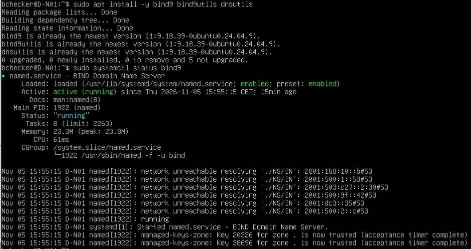

*Instal·lació de bind9 i estat del servei.*

Opcions generals, al fitxer /etc/bind/named.conf.options. El servidor escolta a la seva IP i a localhost, accepta consultes de les dues xarxes i reenvia a 8.8.8.8:

```bash
options {
    directory "/var/cache/bind";
    listen-on { 127.0.0.1; 10.3.2.20; };
    allow-query { localhost; 10.3.1.0/24; 10.3.2.0/24; };
    recursion yes;
    allow-recursion { localhost; 10.3.1.0/24; 10.3.2.0/24; };
    forwarders { 8.8.8.8; };
    dnssec-validation auto;
};
```

Zones, al fitxer /etc/bind/named.conf.local: una zona directa i dues zones inverses, perquè la DMZ (10.3.1.0/24) i la Intranet (10.3.2.0/24) tenen cadascuna la seva subxarxa:

```bash
zone "g03.intra" {
    type master;
    file "/etc/bind/db.g03.intra";
};

zone "2.3.10.in-addr.arpa" {
    type master;
    file "/etc/bind/db.10.3.2";
};

zone "1.3.10.in-addr.arpa" {
    type master;
    file "/etc/bind/db.10.3.1";
};
```

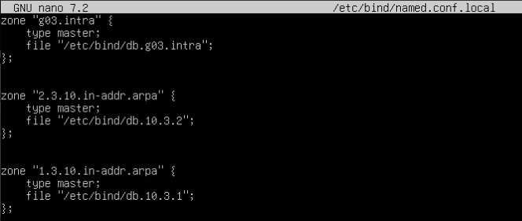

*Fitxers named.conf.options i named.conf.local editats i validats amb named-checkconf.*

Registres de la zona directa, al fitxer /etc/bind/db.g03.intra. El serial s'ha d'incrementar cada vegada que es canvia el fitxer, perquè els canvis es propaguin:

```bash
$TTL 3600
@       IN  SOA  D-N01.g03.intra. admin.g03.intra. (
                 2026110501 ; serial (AAAAMMDDnn)
                 3600       ; refresh
                 900        ; retry
                 604800     ; expire
                 300 )      ; negative cache
@       IN  NS     D-N01.g03.intra.
D-N01   IN  A      10.3.2.20
R-N01   IN  A      10.3.2.1
R       IN  CNAME  R-N01
B-N01   IN  A      10.3.2.10
F-N01   IN  A      10.3.1.10
W-N01   IN  A      10.3.1.20
```

Validació de la zona directa:

```bash
sudo named-checkzone g03.intra /etc/bind/db.g03.intra
```

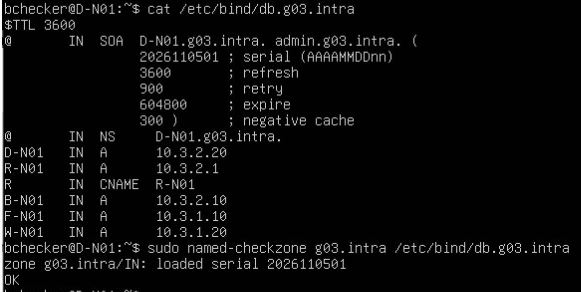

*Fitxer de la zona directa db.g03.intra, validat amb named-checkzone.*

Registres de les zones inverses, als fitxers /etc/bind/db.10.3.2 (Intranet) i /etc/bind/db.10.3.1 (DMZ). Cada fitxer té el mateix encapçalament SOA i NS que la zona directa, i només canvien els PTR:

```bash
; db.10.3.2 (Intranet)
1       IN  PTR  R-N01.g03.intra.
10      IN  PTR  B-N01.g03.intra.
20      IN  PTR  D-N01.g03.intra.

; db.10.3.1 (DMZ)
1       IN  PTR  R-N01.g03.intra.
10      IN  PTR  F-N01.g03.intra.
20      IN  PTR  W-N01.g03.intra.
```

Validació de les zones inverses:

```bash
sudo named-checkzone 2.3.10.in-addr.arpa /etc/bind/db.10.3.2
sudo named-checkzone 1.3.10.in-addr.arpa /etc/bind/db.10.3.1
```

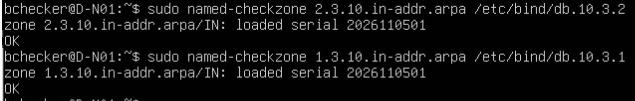

*Fitxers de les zones inverses de la Intranet i la DMZ, validats amb named-checkzone.*

Abans de reiniciar el servei, es valida la configuració completa i es reinicia bind9:

```bash
sudo named-checkconf
sudo systemctl restart bind9
sudo systemctl status bind9
```


Quan el DNS funciona, D-N01 deixa de fer servir el DNS temporal 8.8.8.8 del netplan i es fa servir a si mateix. Al fitxer /etc/netplan/50-cloud-init.yaml, el camp nameservers passa a 127.0.0.1, i després s'aplica amb sudo netplan apply.

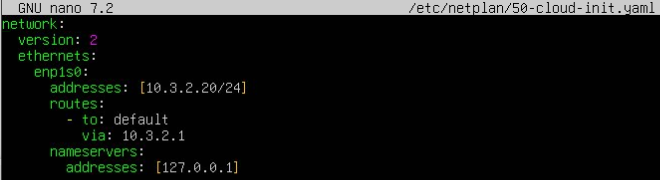

*Netplan amb el DNS de la màquina apuntant a 127.0.0.1.*

**Comprovació.** Les consultes es fan a la IP de D-N01 (10.3.2.20) per comprovar cada part del servei: els registres directes, l'àlies, els inversos i el reenviament cap a Internet.

```bash
dig @10.3.2.20 D-N01.g03.intra +short
dig @10.3.2.20 R.g03.intra +short
dig @10.3.2.20 -x 10.3.2.10 +short
dig @10.3.2.20 www.google.com +short
```

| Consulta | Resultat obtingut |
| --- | --- |
| D-N01.g03.intra	| 10.3.2.20 |
| R.g03.intra	| Àlies de R-N01.g03.intra., que resol a 10.3.2.1 |
| -x 10.3.2.10 (PTR) | B-N01.g03.intra. |
| www.google.com |	Diverses IPs públiques (142.251.x.x), cosa que demostra que el reenviament a 8.8.8.8 funciona. |


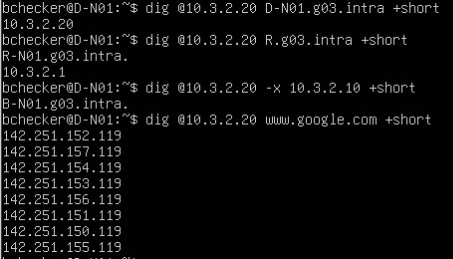

*Respostes de dig per als registres directes, l'àlies, el PTR i el reenviament cap a Internet.*
