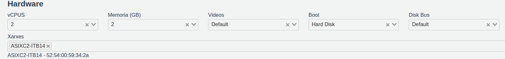
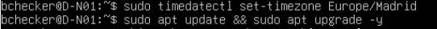
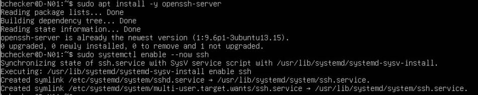
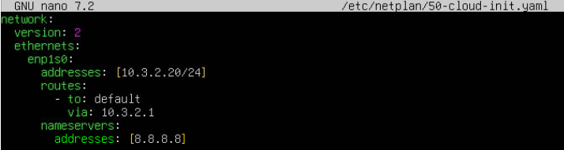
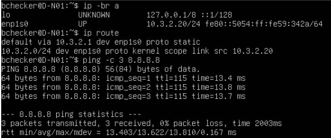

# D-N01 – DNS i DHCP

D-N01 és el servidor de noms i de configuració de xarxa de la Intranet. Ofereix el servei DHCP perquè els clients rebin IP, gateway i DNS de manera automàtica, i el servei DNS perquè totes les màquines es resolguin pel nom. Té una única interfície, a ITB14, perquè és una màquina de la Intranet.

## 1. Creació de la màquina

La màquina s'ha creat a IsardVDI a partir de la plantilla **Ubuntu Server 24.04**, com la resta de servidors del projecte. Té una sola interfície perquè només ha de treballar dins de la Intranet.

| Paràmetre | Valor | Justificació |
|---|---|---|
| vCPUs | 2 | El DNS i el DHCP consumeixen molt poca CPU |
| Memòria | 2 GB | Suficient per a Ubuntu Server sense entorn gràfic |
| Disc | Hard Disk (per defecte) | El de la plantilla |

### Adaptadors de xarxa

El servidor només té un adaptador, a la Intranet. No té la interfície Default, perquè la sortida a Internet la fa el router: els paquets de D-N01 surten pel gateway 10.3.2.1 i el NAT de R-N01 els deixa sortir.

| Adaptador | Xarxa d'Isard | MAC | Interfície | Ús |
|---|---|---|---|---|
| 1 | ASIXC2-ITB14 | 52:54:00:59:34:2a | `enp1s0` | Intranet. IP fixa 10.3.2.20/24, gateway 10.3.2.1 |



*Configuració de recursos i xarxes de l'escriptori D-N01 a IsardVDI.*

## 2. Configuració base

Aquesta configuració s'aplica igual a totes les màquines del projecte. Així totes queden homogènies i compleixen el requisit de l'usuari bchecker.

### 2.1 Nom de la màquina i usuari bchecker

```bash
sudo hostnamectl set-hostname D-N01
sudo adduser bchecker
sudo usermod -aG sudo bchecker
```

- **`hostnamectl set-hostname`** canvia el nom de la màquina de forma persistent. És el nom que el DNS ha de resoldre i el que els clients veuran a la xarxa.
- **`adduser bchecker`** crea l'usuari amb el seu directori personal i li assigna la contrasenya `bchecker121`. Els camps d'informació personal s'han deixat en blanc perquè no són necessaris. L'enunciat exigeix aquest usuari a tots els sistemes, per a la correcció.
- **`usermod -aG sudo bchecker`** afegeix l'usuari al grup `sudo`, perquè pugui administrar la màquina. L'opció `-a` (*append*) és important: sense ella, l'usuari perdria la resta de grups als quals pertany.


*Canvi de hostname i creació de l'usuari bchecker.*

### 2.2 Zona horària i actualització del sistema

```bash
sudo timedatectl set-timezone Europe/Madrid
sudo apt update && sudo apt upgrade -y
```

- **Zona horària Europe/Madrid:** els logs del DNS i del DHCP han de tenir l'hora local. Si no, és difícil relacionar-los amb les proves i les captures dels clients.
- **`apt update`** actualitza la llista de paquets disponibles, i **`apt upgrade -y`** instal·la les actualitzacions pendents. Es fa abans d'instal·lar bind9 i el servidor DHCP, perquè la plantilla pot tenir paquets antics amb vulnerabilitats conegudes. Durant l'actualització, el sistema ha demanat el joc de caràcters de la consola i s'ha triat *Latin1 and Latin5*, que és el que suporta els accents del català i del castellà.



*Configuració de la zona horària i actualització del sistema.*

### 2.3 Accés SSH

```bash
sudo apt install -y openssh-server
sudo systemctl enable --now ssh
```

- El paquet `openssh-server` ja venia instal·lat a la plantilla, com indica el missatge *"already the newest version"*. Tot i així, s'executa l'ordre per assegurar-ho.
- **`systemctl enable --now ssh`** arrenca el servei immediatament (`--now`) i el deixa activat perquè arrenqui sol en cada reinici (`enable`). Això permet administrar D-N01 en remot, i el professor hi pot entrar amb l'usuari bchecker.



*Instal·lació i activació del servei SSH.*

### 2.4 Configuració de xarxa (netplan)

**Què fa.** Assigna a l'única interfície la IP fixa de la Intranet i el gateway del router, perquè la màquina surti a Internet a través de R-N01. Com que no té DHCP, el DNS s'indica de manera temporal (8.8.8.8) fins que D-N01 estigui operatiu.

**Configuració.** Fitxer `/etc/netplan/50-cloud-init.yaml`. Abans, s'ha desactivat la configuració de xarxa de cloud-init perquè no el sobreescrigui en reiniciar.

```yaml
network:
  version: 2
  ethernets:
    enp1s0:                        # ASIXC2-ITB14: Intranet
      addresses: [10.3.2.20/24]
      routes:
        - to: default
          via: 10.3.2.1
      nameservers:
        addresses: [8.8.8.8]       # temporal, fins que D-N01 resolgui
```



*Fitxer de configuració de netplan editat amb nano.*

### 2.5 Comprovació

```bash
hostnamectl | grep hostname
id bchecker
timedatectl | grep "Time zone"
systemctl status ssh
ip -br a
ip route
ping -c 3 8.8.8.8
```

| Comprovació | Resultat obtingut |
|---|---|
| Hostname | `Static hostname: D-N01` |
| Usuari bchecker | Inclòs al grup `27(sudo)` |
| Zona horària | `Europe/Madrid (CEST, +0200)` |
| Servei SSH | `active (running)` i `enabled` |
| Netplan | IP de `enp1s0` (10.3.2.20/24) i ruta per defecte via 10.3.2.1 |
| Sortida a Internet | `ping` a 8.8.8.8 respon, passant pel router |

A més, aquestes comprovacions ja s'han fet havent iniciat sessió com a **bchecker** (el prompt mostra `bchecker@D-N01`). Això demostra que l'usuari funciona i que pot fer servir `sudo`.




*Comprovació final de la configuració base i de la xarxa.*

