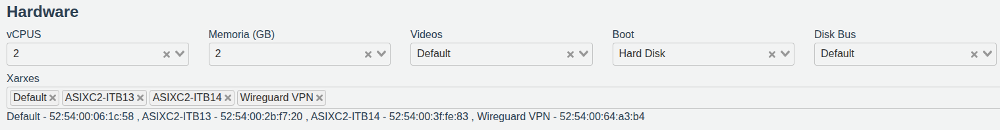
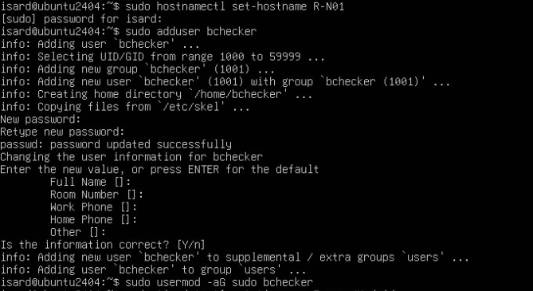
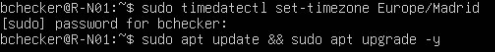
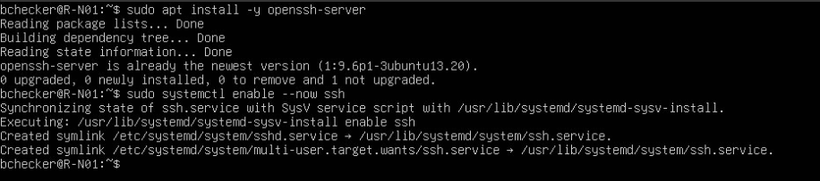
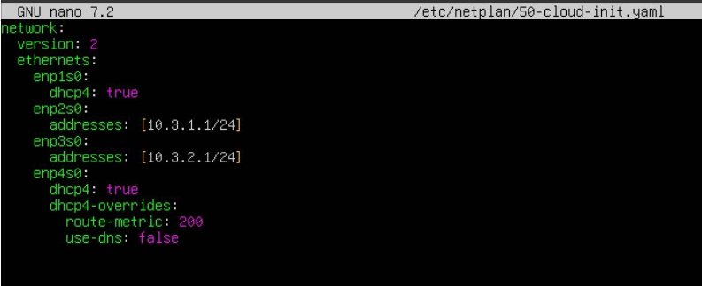
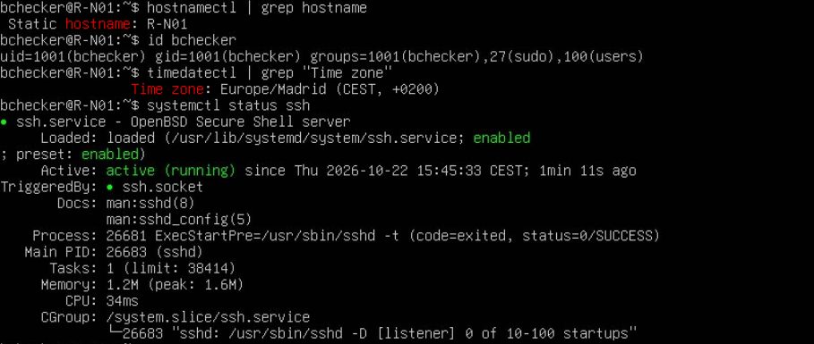
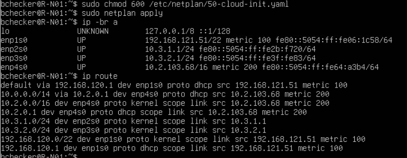

# D-N01 – DNS-DHCP

R-N01 és el router de la infraestructura. Connecta la DMZ i la Intranet entre elles i amb Internet, fa NAT perquè les màquines internes puguin sortir a l'exterior, i més endavant farà de tallafocs entre les dues xarxes. És la primera màquina que es desplega, perquè la resta depenen d'ella per tenir connectivitat.

## 1. Creació de la màquina

La màquina s'ha creat a IsardVDI a partir de la plantilla **Ubuntu Server 24.04**. S'ha triat Ubuntu Server perquè no té entorn gràfic, i per tant consumeix pocs recursos i redueix la superfície d'atac. A més, la versió 24.04 és LTS i rep actualitzacions de seguretat fins al 2029.

| Paràmetre | Valor | Justificació |
|---|---|---|
| vCPUs | 2 | Recursos suficients |
| Memòria | 2 GB | Suficient per a Ubuntu Server sense entorn gràfic |
| Disc | Hard Disk (per defecte) | El de la plantilla |

### Adaptadors de xarxa

El router és l'única màquina que té una interfície a cada xarxa, perquè és qui ha de passar el trànsit d'una a l'altra.

| Adaptador | Xarxa d'Isard | MAC | Interfície | Ús |
|---|---|---|---|---|
| 1 | Default | 52:54:00:06:1c:58 | `enp1s0` | Sortida a Internet. Rep la IP per DHCP de la xarxa NAT d'Isard |

S'han apuntat les adreces MAC perquè dins del sistema les interfícies es diuen `enp1s0`, `enp2s0`, etc. Comparant les MAC és l'única manera segura de saber quina interfície correspon a cada xarxa abans de configurar les IPs.



*Configuració de recursos i xarxes de l'escriptori R-N01 a IsardVDI.*

## 2. Configuració base

Aquesta configuració s'aplica igual a totes les màquines del projecte. Així totes queden homogènies i compleixen el requisit de l'usuari bchecker.

### 2.1 Nom de la màquina i usuari bchecker

```bash
sudo hostnamectl set-hostname R-N01
sudo adduser bchecker
sudo usermod -aG sudo bchecker
```

- **`hostnamectl set-hostname`** canvia el nom de la màquina de forma persistent. El nom segueix la nomenclatura del projecte i és el que després resoldrà el DNS. El prompt no canvia fins que es torna a iniciar sessió, per això a la captura encara es veu `ubuntu2404`.
- **`adduser bchecker`** crea l'usuari amb el seu directori personal i li assigna la contrasenya `bchecker121`. Els camps d'informació personal s'han deixat en blanc perquè no són necessaris. L'enunciat exigeix aquest usuari a tots els sistemes, per a la correcció.
- **`usermod -aG sudo bchecker`** afegeix l'usuari al grup `sudo`, perquè pugui administrar la màquina. L'opció `-a` (*append*) és important: sense ella, l'usuari perdria la resta de grups als quals pertany.



*Canvi de hostname i creació de l'usuari bchecker.*

### 2.2 Zona horària i actualització del sistema

```bash
sudo timedatectl set-timezone Europe/Madrid
sudo apt update && sudo apt upgrade -y
```

- **Zona horària Europe/Madrid:** els logs del sistema i dels serveis han de tenir l'hora local. Si no, és difícil relacionar-los amb les proves i les captures, i en un context de seguretat és clau saber exactament quan ha passat cada cosa.
- **`apt update`** actualitza la llista de paquets disponibles, i **`apt upgrade -y`** instal·la les actualitzacions pendents. Es fa abans de configurar cap servei, perquè la plantilla pot tenir paquets antics amb vulnerabilitats conegudes. Durant l'actualització, el sistema ha demanat el joc de caràcters de la consola i s'ha triat *Latin1 and Latin5*, que és el que suporta els accents del català i del castellà. 



*Configuració de la zona horària i actualització del sistema.*

### 2.3 Accés SSH

```bash
sudo apt install -y openssh-server
sudo systemctl enable --now ssh
```

- El paquet `openssh-server` ja venia instal·lat a la plantilla, com indica el missatge *"already the newest version"*. Tot i així, s'executa l'ordre per assegurar-ho.
- **`systemctl enable --now ssh`** arrenca el servei immediatament (`--now`) i el deixa activat perquè arrenqui sol en cada reinici (`enable`). Això és el que permet administrar el router en remot, i el que permetrà al professor entrar-hi amb l'usuari bchecker.



*Instal·lació i activació del servei SSH.*

### 2.4 Configuració de xarxa (netplan)

**Què fa.** Assigna a cada interfície la seva xarxa: la Default obté IP per DHCP d'Isard i és la sortida a Internet, mentre que ITB13 (DMZ) i ITB14 (Intranet) reben una IP fixa, que fa de *gateway* de cada xarxa. La VPN també obté IP per DHCP, però amb una mètrica més alta perquè la ruta per defecte continuï sortint per la Default.

**Configuració.** Fitxer `/etc/netplan/50-cloud-init.yaml`. Abans, s'ha desactivat la configuració de xarxa de cloud-init perquè no el sobreescrigui en reiniciar.

```yaml
network:
  version: 2
  ethernets:
    enp1s0:
      dhcp4: true
    enp2s0:
      addresses: [10.3.1.1/24]
    enp3s0:
      addresses: [10.3.2.1/24]
    enp4s0:
      dhcp4: true
      dhcp4-overrides:
        route-metric: 200
        use-dns: false
```



*Fitxer de configuració de netplan editat amb nano.*

### 2.5 Comprovació

```bash
hostnamectl | grep hostname
id bchecker
timedatectl | grep "Time zone"
systemctl status ssh
ip -br a
ip route
```

| Comprovació | Resultat obtingut |
|---|---|
| Hostname | `Static hostname: R-N01` |
| Usuari bchecker | uid 1001, inclòs al grup `27(sudo)` |
| Zona horària | `Europe/Madrid (CEST, +0200)` |
| Servei SSH | `active (running)` i `enabled` |
| Netplan | Ip's de les interfícies i taula d'enrutament |

A més, aquestes comprovacions ja s'han fet havent iniciat sessió com a **bchecker** (el prompt mostra `bchecker@R-N01`). Això demostra que l'usuari funciona i que pot fer servir `sudo`.




*Comprovació final de la configuració base.*
