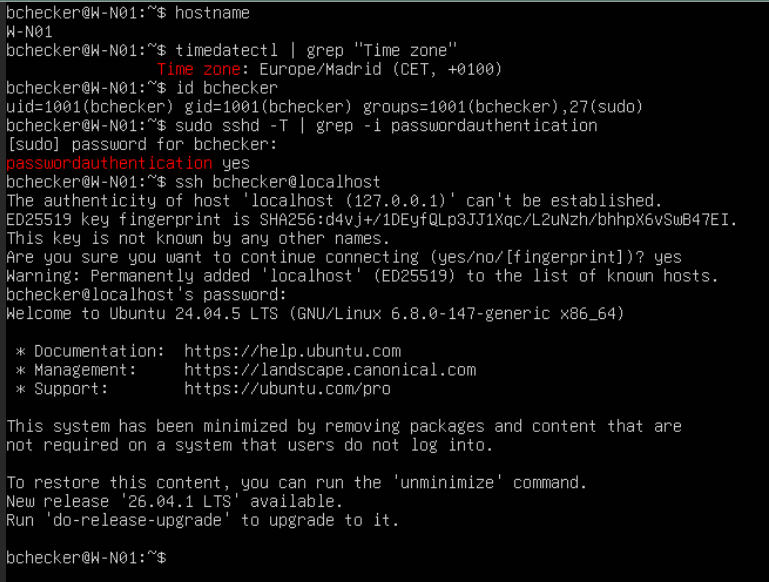
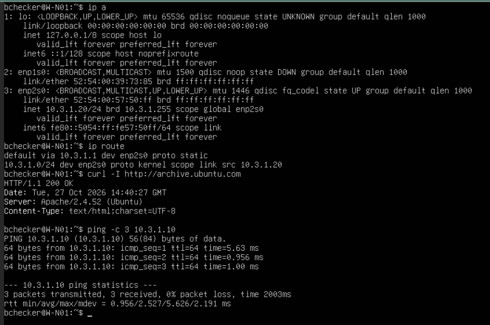
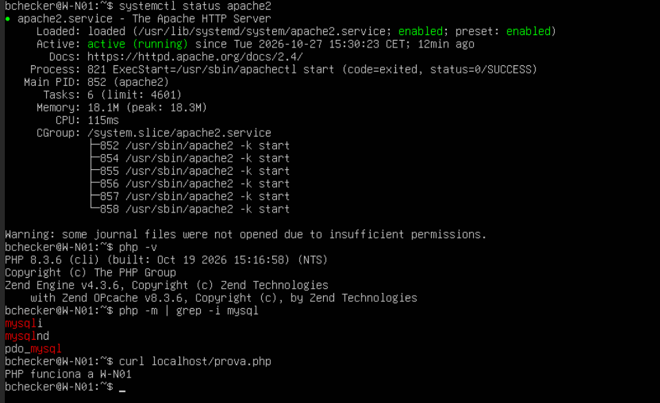
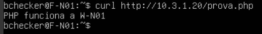

# W-N01: Servidor web
 
Responsable: Marc Balastegui
 
| Paràmetre | Valor |
|---|---|
| Hostname | W-N01 |
| Sistema | Ubuntu Server 24.04 |
| Xarxa | DMZ (ITB13) |
| IP | 10.3.1.20/24 |
| Gateway | 10.3.1.1 (R-N01) |
| Serveis | SSH, Apache 2, PHP 8.3 |
 
---

## 1. Configuració de la màquina a IsardVDI
 

 

| Paràmetre | Valor | Perquè |
|---|---|---|
| Plantilla | Ubuntu Server 24.04 (catàleg d'Isard) | És l'última versió disponible d'Ubuntu Server |
| vCPU | 2 | És un servei molt lleuger, així que no es necessiten molts recursos |
| RAM | 4 | És un servei molt lleuger, així que no es necessiten molts recursos |
| Disc | Default | No fa falta canviar cap configuració aquí |
 
 ### Interfícies de xarxa
 
| Interfície Isard | Nom a Linux | MAC | Ús |
|---|---|---|---|
| Default | enp1s0 | 52:54:00:39:73:85 | Temporal: sortida a Internet per instal·lar paquets |
| ITB13 | enp2s0 | 52:54:00:57:50:ff | DMZ, IP fixa 10.3.1.20 |
 
**Per què la interfície Default és temporal:** la DMZ ha de sortir a Internet a través de R-N01, no directament per Isard. Si es deixés la Default, el tallafocs del router no serviria de res, perquè el trànsit no hi passaria. Es manté només mentre R-N01 no funciona, per poder instal·lar paquets.

---


## 2. Configuració base
 
### 2.1 Sistema i paquets bàsics
 
```bash
sudo apt update && sudo apt full-upgrade -y
sudo apt install -y openssh-server vim curl git net-tools iputils-ping
sudo systemctl enable --now ssh
```
 
> La plantilla d'Isard és una instal·lació mínima i no inclou `ping` (paquet `iputils-ping`).


### 2.2 Hostname i zona horària
 
```bash
sudo hostnamectl set-hostname W-N01
sudo timedatectl set-timezone Europe/Madrid
```
 
A `/etc/hosts`:
 
```
127.0.1.1 W-N01
```
 
### 2.3 Usuari bchecker
 
L'enunciat exigeix l'usuari `bchecker` / `bchecker121` a tots els equips.
 
```bash
sudo useradd -m -s /bin/bash -G sudo bchecker
echo 'bchecker:bchecker121' | sudo chpasswd
```
 
- `-m` crea el directori personal
- `-s /bin/bash` li assigna un intèrpret d'ordres
- `-G sudo` li dona permisos d'administració
### 2.4 Xarxa (netplan)
 
Hi ha **un fitxer per interfície**. Totes dues s'identifiquen per MAC i no pel nom, perquè en treure la Default a Isard la ITB13 pot canviar de nom (de `enp2s0` a `enp1s0`), i la MAC no canvia.
 
**Interfície Default** ([`config/W-N01/50-cloud-init.yaml`](../config/W-N01/50-cloud-init.yaml)):
 
```yaml
network:
  version: 2
  ethernets:
    default:
      match:
        macaddress: "52:54:00:39:73:85"
      dhcp4: true
```
 
**Interfície ITB13, DMZ** ([`config/W-N01/60-itb13.yaml`](../config/W-N01/60-itb13.yaml)):
 
```yaml
network:
  version: 2
  ethernets:
    itb13:
      match:
        macaddress: "52:54:00:57:50:ff"
      dhcp4: false
      mtu: 1446
      addresses: [10.3.1.20/24]
```
 
`mtu: 1446` és el valor de les xarxes d'Isard. Amb el valor per defecte (1500), els paquets grans es perden.
 
Perquè cloud-init no reescrigui la configuració de xarxa en reiniciar:
 
```bash
echo 'network: {config: disabled}' | sudo tee /etc/cloud/cloud.cfg.d/99-disable-network-config.cfg
```
 
Aplicació:
 
```bash
sudo chmod 600 /etc/netplan/*.yaml
sudo netplan try
```
 
`netplan try` aplica la configuració i la desfà sola si no es confirma en 120 segons.
 
### 2.5 Incidència: pèrdua d'Internet en aplicar netplan
 
**Què va passar:** en el primer intent es va substituir el contingut del fitxer original de netplan (el que configurava la Default per DHCP) per la configuració de la ITB13. En aplicar-lo, la Default es va quedar sense IP i la màquina sense sortida a Internet.
 
**Diagnòstic:**
 
- `curl -I http://archive.ubuntu.com` → *Could not resolve host*
- `curl -I http://91.189.91.81` → *Couldn't connect to server*. No era només el DNS: no hi havia sortida
- `ip route` → només hi havia la ruta de la DMZ, cap ruta `default`
**Solució:** separar la configuració en dos fitxers, un per interfície, com es mostra a l'apartat 2.4.
 
**Lliçó:** netplan només configura les interfícies que té definides. Si se n'esborra una dels fitxers, en reaplicar-lo es queda sense configuració.
 
### 2.6 Comprovacions
 

 
| Ordre | Perquè | Resultat |
|---|---|---|
| `hostname` | Per comprovar el Hostname | `W-N01` |
| `timedatectl \ grep "Time zone"` | Per comprovar que la zona horària és la correcta | `Europe/Madrid` |
| `id bchecker` | Per comprovar els grups pertinents a l'usuari | `groups=1001(bchecker),27(sudo)` |
| `sudo sshd -T \ grep -i passwordauthentication` | Per comprovar que SSH accepta contrasenya i usuari | `yes` |
| `ssh bchecker@localhost` | Per veure que entra per SSH | `Welcome to Ubuntu (...)`|
 

 
| Ordre | Perquè | Resultat |
|---|---|---|
| `ip a` | Per veure la IP que hem configurat de la interfície de xarxa del router | `10.3.1.20/24` a la ITB13 |
| `ip route` | Per veure les rutes de xarxa i comprovar que hi ha ruta cap al Router | `default` per la Default i `10.3.1.0/24` per la ITB13  |
| `curl -I http://archive.ubuntu.com` | Comprovar que hi ha sortida a Internet  | `HTTP(...)`,Respon |
| `ping -c 3 10.3.1.10` | Comprovar que hi ha resposta cap a la màquina F-N01 |  `64 bytes(...)`, Hi ha connectivitat |
---
 
## 3. Instal·lació del servei: Apache i PHP
 
### 3.1 Què s'instal·la
 
- **Apache:** el servidor web. Rep les peticions dels navegadors i els retorna les pàgines.
- **PHP:** genera pàgines dinàmiques. L'aplicació el farà servir per consultar la BBDD de B-N01 i mostrar-ne les dades.
- **libapache2-mod-php:** connecta Apache amb PHP, perquè els fitxers `.php` s'executin en lloc de descarregar-se com a text.
- **php-mysql:** permet a PHP connectar-se a MySQL.
```bash
sudo apt install -y apache2 php libapache2-mod-php php-mysql
```
 
### 3.2 Pàgina de prova
 
Pàgina mínima per comprovar que Apache i PHP treballen junts:
 
```bash
echo '<?php echo "PHP funciona a " . gethostname() . "\n"; ?>' | sudo tee /var/www/html/prova.php
```
 
### 3.3 Comprovacions
 

 
| Prova | Ordre | Esperat | Resultat |
|---|---|---|---|
| Apache actiu | `systemctl status apache2` | `active (running)` i `enabled` | |
| Versió de PHP | `php -v` | PHP 8.3 | |
| Mòduls MySQL | `php -m \| grep -i mysql` | `mysqli`, `mysqlnd`, `pdo_mysql` | |
| Apache + PHP | `curl localhost/prova.php` | `PHP funciona a W-N01` | |
 

 
| Prova | Ordre (des de F-N01) | Esperat | Resultat |
|---|---|---|---|
| Web accessible des de la DMZ | `curl http://10.3.1.20/prova.php` | `PHP funciona a W-N01` | |
