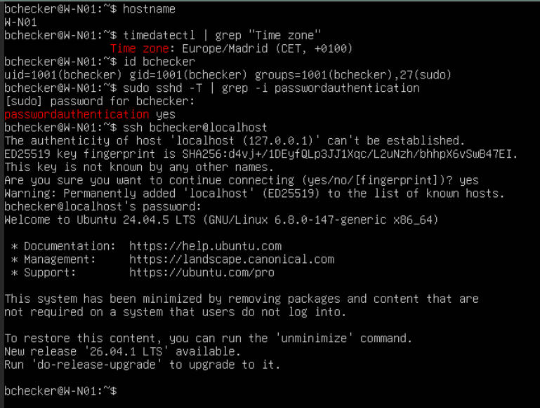
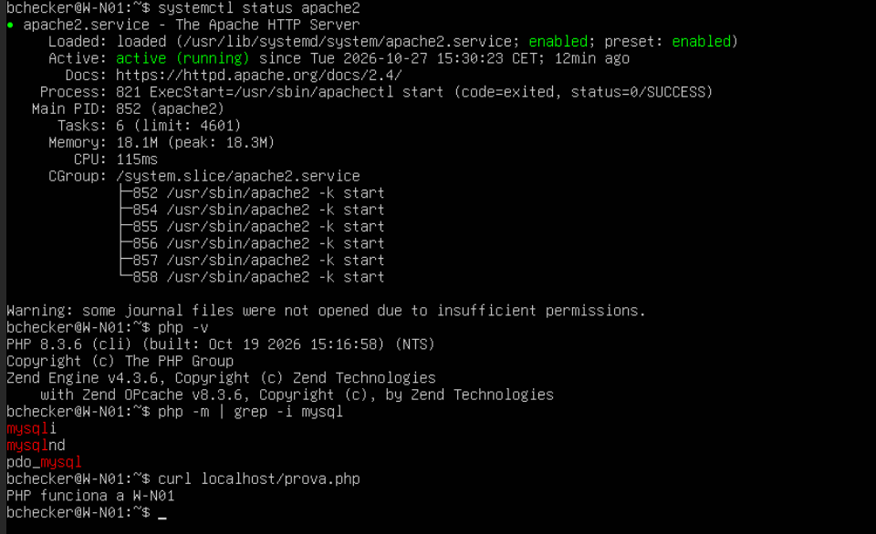
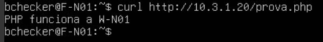
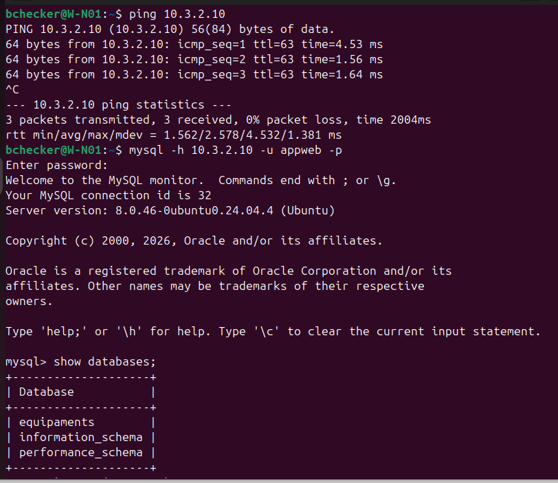
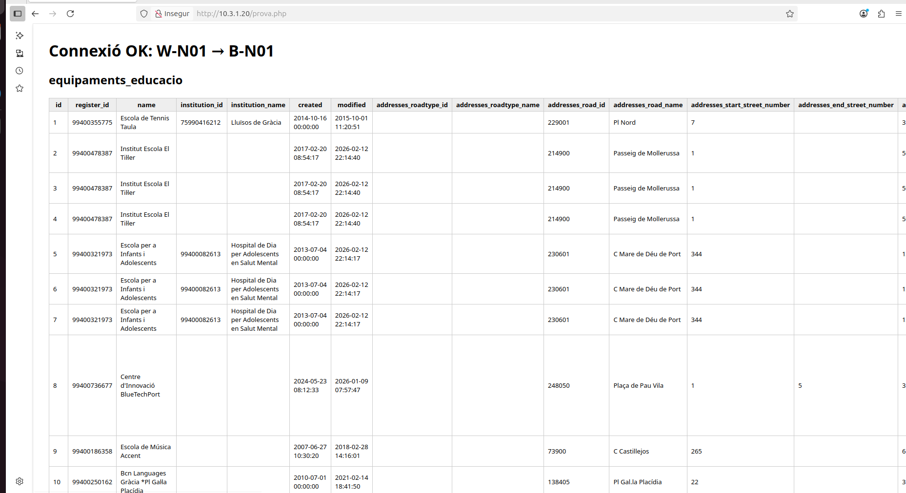
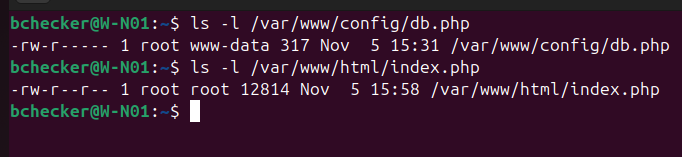
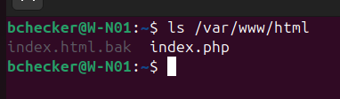
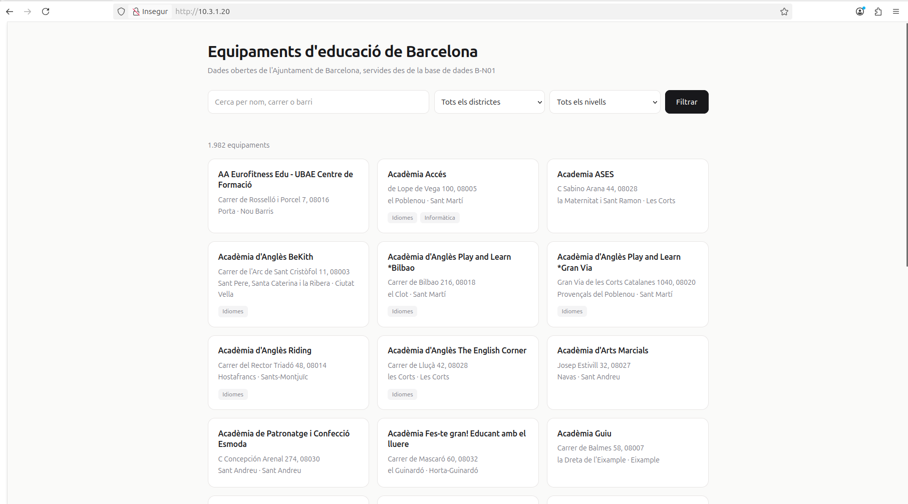

# W-N01 – Servidor web

W-N01 és el servidor web de la infraestructura. És a la DMZ perquè és un servei pensat per ser consultat des de fora, i serveix l'aplicació que mostra les dades de la base de dades de B-N01. Surt a Internet a través de R-N01, de manera que tot el seu trànsit passa pel router.

## 1. Creació de la màquina

La màquina s'ha creat a IsardVDI a partir de la plantilla **Ubuntu Server 24.04**. S'ha triat Ubuntu Server perquè no té entorn gràfic, i per tant consumeix pocs recursos i redueix la superfície d'atac. A més, la versió 24.04 és LTS i rep actualitzacions de seguretat fins al 2029.

| Paràmetre | Valor | Justificació |
|---|---|---|
| vCPUs | 2 | Apache i PHP consumeixen poca CPU amb el volum de peticions del projecte |
| Memòria | 4 GB | Ubuntu Server sense entorn gràfic, amb marge per a Apache i PHP quan l'aplicació consulti la base de dades |
| Disc | Hard Disk (per defecte) | El de la plantilla |

### Adaptadors de xarxa

| Adaptador | Xarxa d'Isard | MAC | Interfície | Ús |
|---|---|---|---|---|
| 1 | Default | 52:54:00:39:73:85 | `enp1s0` | Només per instal·lar paquets abans que R-N01 funcionés. Ara sense configuració |
| 2 | ASIXC2-ITB13 | 52:54:00:57:50:ff | `enp2s0` | DMZ. IP fixa 10.3.1.20/24, gateway 10.3.1.1 (R-N01) |

S'han apuntat les adreces MAC perquè dins del sistema les interfícies es diuen `enp1s0`, `enp2s0`, etc. Comparant les MAC és l'única manera segura de saber quina interfície correspon a cada xarxa abans de configurar les IPs.

La interfície Default és temporal: la DMZ ha de sortir a Internet a través de R-N01, no directament per Isard. Si es mantingués activa, el trànsit no passaria pel router i el tallafocs no serviria de res.


*Configuració de recursos i xarxes de l'escriptori W-N01 a IsardVDI.*

## 2. Configuració base

Aquesta configuració s'aplica igual a totes les màquines del projecte. Així totes queden homogènies i compleixen el requisit de l'usuari bchecker.

### 2.1 Nom de la màquina i usuari bchecker

```bash
sudo hostnamectl set-hostname W-N01
sudo useradd -m -s /bin/bash -G sudo bchecker
echo 'bchecker:bchecker121' | sudo chpasswd
```

A `/etc/hosts`, la línia del propi equip:

```
127.0.1.1 W-N01
```

- **`hostnamectl set-hostname`** canvia el nom de la màquina de forma persistent. El nom segueix la nomenclatura del projecte i és el que després resoldrà el DNS. El prompt no canvia fins que es torna a iniciar sessió.
- **`/etc/hosts`** s'actualitza perquè la màquina pugui resoldre el seu propi nom. Si no, ordres com `sudo` mostren un avís perquè no troben el hostname.
- **`useradd -m -s /bin/bash -G sudo bchecker`** crea l'usuari que l'enunciat exigeix a tots els sistemes, per a la correcció:
  - `-m` crea el seu directori personal.
  - `-s /bin/bash` li assigna bash com a intèrpret d'ordres.
  - `-G sudo` l'afegeix al grup `sudo`, perquè pugui administrar la màquina.
- **`chpasswd`** li assigna la contrasenya `bchecker121` sense haver-la d'escriure de forma interactiva.

### 2.2 Zona horària i actualització del sistema

```bash
sudo timedatectl set-timezone Europe/Madrid
sudo apt update && sudo apt full-upgrade -y
sudo apt install -y vim curl git net-tools iputils-ping
```

- **Zona horària Europe/Madrid:** els logs del sistema i dels serveis han de tenir l'hora local. Si no, és difícil relacionar-los amb les proves i les captures, i en un context de seguretat és clau saber exactament quan ha passat cada cosa.
- **`apt update`** actualitza la llista de paquets disponibles, i **`apt full-upgrade -y`** instal·la les actualitzacions pendents. A diferència d'`apt upgrade`, també pot instal·lar o treure paquets si una actualització ho necessita (per exemple, un nucli nou). Es fa abans de configurar cap servei, perquè la plantilla pot tenir paquets antics amb vulnerabilitats conegudes.
- **Eines bàsiques:** la plantilla d'Isard és una instal·lació mínima. S'hi afegeixen `vim` (editor), `curl` (proves HTTP), `git` (desplegament de l'aplicació), `net-tools` i `iputils-ping` (diagnòstic de xarxa; la plantilla no inclou ni l'ordre `ping`).

### 2.3 Accés SSH

```bash
sudo apt install -y openssh-server
sudo systemctl enable --now ssh
```

- El paquet `openssh-server` ja venia instal·lat a la plantilla, com indica el missatge *"already the newest version"*. Tot i així, s'executa l'ordre per assegurar-ho.
- **`systemctl enable --now ssh`** arrenca el servei immediatament (`--now`) i el deixa activat perquè arrenqui sol en cada reinici (`enable`). Això és el que permet administrar el servidor en remot, i el que permetrà al professor entrar-hi amb l'usuari bchecker.
- Perquè bchecker pugui entrar amb contrasenya, SSH ha de tenir l'autenticació per contrasenya activada. Es comprova a l'apartat 2.5 amb `sshd -T`, que mostra la configuració que s'aplica realment, incloent-hi els fitxers de `/etc/ssh/sshd_config.d/`.

### 2.4 Configuració de xarxa (netplan)

**Què fa.** Assigna a la interfície ITB13 la IP fixa de la DMZ i fa que tot el trànsit cap a fora surti per R-N01 (10.3.1.1). El DNS és provisionalment 8.8.8.8, fins que D-N01 estigui operatiu.

**Configuració.** Fitxer `/etc/netplan/60-itb13.yaml`. Abans, s'ha desactivat la configuració de xarxa de cloud-init perquè no sobreescrigui netplan en reiniciar.

```bash
echo 'network: {config: disabled}' | sudo tee /etc/cloud/cloud.cfg.d/99-disable-network-config.cfg
```

```yaml
network:
  version: 2
  ethernets:
    itb13:
      match:
        macaddress: "52:54:00:57:50:ff"
      dhcp4: false
      mtu: 1446
      addresses: [10.3.1.20/24]
      routes:
        - to: default
          via: 10.3.1.1
      nameservers:
        addresses: [8.8.8.8]
```

```bash
sudo chmod 600 /etc/netplan/*.yaml
sudo netplan try
```

- **`match: macaddress`:** la interfície s'identifica per la MAC i no pel nom. Si es treu la Default a Isard, la ITB13 pot passar a dir-se `enp1s0`, i una configuració per nom deixaria de funcionar. La MAC no canvia.
- **`mtu: 1446`:** és el valor de les xarxes d'Isard. Amb el valor per defecte (1500), els paquets grans es perden i ordres com `apt` es queden penjades.
- **`netplan try`:** aplica la configuració i la desfà sola si no es confirma en 120 segons. Si un error deixa la màquina sense xarxa, es recupera sense haver de fer res.

**Procés.** Mentre R-N01 no funcionava, la màquina tenia un segon fitxer (`50-cloud-init.yaml`) que donava IP per DHCP a la interfície Default, per poder instal·lar paquets. Quan el router va estar operatiu, es va afegir el gateway 10.3.1.1 a la ITB13 i es va eliminar aquest fitxer.

**Incidència.** En el primer intent, en lloc de crear un fitxer nou per a la ITB13, es va substituir el contingut del fitxer original, que configurava la Default. En aplicar-lo, la Default es va quedar sense IP i la màquina sense sortida a Internet:

- `curl -I http://archive.ubuntu.com` → *Could not resolve host*
- `curl -I http://91.189.91.81` → *Couldn't connect to server*. No era només el DNS: no hi havia cap sortida.
- `ip route` → només hi havia la ruta de la DMZ, cap ruta `default`.

Es va solucionar separant la configuració en un fitxer per interfície. La causa és que netplan només configura les interfícies que té definides: si se n'esborra una dels fitxers, en reaplicar-los es queda sense configuració.

### 2.5 Comprovació

```bash
hostname
id bchecker
timedatectl | grep "Time zone"
sudo sshd -T | grep -i passwordauthentication
ssh bchecker@localhost
ip a
ip route
curl -I http://archive.ubuntu.com
ping -c 3 10.3.1.10
```

| Comprovació | Resultat obtingut |
|---|---|
| Hostname | `W-N01` |
| Usuari bchecker | `uid=1001(bchecker)`, inclòs al grup `27(sudo)` |
| Zona horària | `Europe/Madrid` |
| Servei SSH | `passwordauthentication yes` i accés per SSH com a bchecker |
| Netplan: IP | `10.3.1.20/24` a `enp2s0` |
| Netplan: rutes | `default via 10.3.1.1 dev enp2s0` i `10.3.1.0/24 dev enp2s0` |
| Sortida a Internet | `curl` rep resposta HTTP de `archive.ubuntu.com` |
| Connectivitat amb F-N01 | `ping` a 10.3.1.10 amb resposta |

A més, aquestes comprovacions ja s'han fet havent iniciat sessió com a **bchecker** (el prompt mostra `bchecker@W-N01`). Això demostra que l'usuari funciona i que pot fer servir `sudo`.




*Comprovació final de la configuració base.*

## 3. Serveis

### 3.1 Servidor web (Apache i PHP)

**Què fa.** Apache és el servidor web: rep les peticions dels navegadors i retorna les pàgines. PHP genera pàgines dinàmiques, i és el que farà servir l'aplicació per consultar la base de dades de B-N01 i mostrar-ne les dades.

**Configuració.**

```bash
sudo apt install -y apache2 php libapache2-mod-php php-mysql
```

- **`apache2`:** el servidor web.
- **`php`:** l'intèrpret de PHP (versió 8.3 a Ubuntu 24.04).
- **`libapache2-mod-php`:** connecta Apache amb PHP. Sense aquest mòdul, Apache no executaria els fitxers `.php` i els retornaria com a text.
- **`php-mysql`:** permet a PHP connectar-se a MySQL, necessari perquè l'aplicació llegeixi la base de dades de B-N01.

Per comprovar que Apache i PHP treballen junts, es crea una pàgina de prova mínima:

```bash
echo '<?php echo "PHP funciona a " . gethostname() . "\n"; ?>' | sudo tee /var/www/html/prova.php
```

**Comprovació.**

```bash
systemctl status apache2
php -v
php -m | grep -i mysql
curl localhost/prova.php
```

- `systemctl status apache2` ha de mostrar `active (running)` i `enabled`, és a dir, que el servei funciona i arrencarà sol en cada reinici.
- `php -v` ha de mostrar PHP 8.3.
- `php -m | grep -i mysql` ha de mostrar els mòduls `mysqli`, `mysqlnd` i `pdo_mysql`.
- `curl localhost/prova.php` ha de retornar `PHP funciona a W-N01`. Si retornés el codi PHP tal qual, voldria dir que Apache no passa els fitxers `.php` a PHP.



*Estat d'Apache, versió de PHP, mòduls de MySQL i pàgina de prova.*

Finalment, es comprova que la web és accessible des d'una altra màquina de la DMZ. Des de F-N01:

```bash
curl http://10.3.1.20/prova.php
```

Retorna `PHP funciona a W-N01`, cosa que demostra que les IPs fixes de la DMZ funcionen i que el servidor web serveix pàgines a altres equips.



*Petició a la pàgina de prova de W-N01 des de F-N01.*

### 3.2 Connexió amb la base de dades de B-N01
 
**Què fa.** W-N01 és la capa web de l'aplicació multicapa: no guarda dades, sinó que les consulta a B-N01 (Intranet) cada vegada que un visitant demana una pàgina. El visitant només parla amb W-N01 i mai arriba a veure la base de dades:
 
```text
Visitant (navegador) ──HTTP :80──► W-N01 (Apache + PHP) ──MySQL :3306──► B-N01 (MySQL)
                                       usuari appweb
```
 
Per a aquesta connexió s'utilitza el compte `appweb`, creat expressament per a l'aplicació: només pot connectar-se des de la IP de W-N01 (`10.3.1.20`) i només té permís de lectura (`SELECT`) sobre la taula `equipaments_educacio`.
 
**Configuració.** Abans de programar res es comprova que PHP disposa del connector de MySQL (PDO) i que W-N01 arriba al port 3306 de B-N01:
 
```bash
php -m | grep -i pdo_mysql
nc -zv -w5 10.3.2.10 3306
```
 
Si falta el connector, s'instal·la amb `sudo apt install -y php-mysql` i es reinicia Apache (`sudo systemctl restart apache2`).
 
**Comprovació.** Amb el client de MySQL es prova l'accés amb el compte de l'aplicació:
 
```bash
sudo apt install -y mysql-client
mysql -h 10.3.2.10 -u appweb -p equipaments -e "SELECT COUNT(*) FROM equipaments_educacio;"
```
 
| Comprovació | Resultat esperat |
|---|---|
| Connector `pdo_mysql` | Apareix a la llista de mòduls de PHP |
| Port 3306 de B-N01 | `succeeded` (el tallafocs de B-N01 deixa passar W-N01) |
| Consulta amb `appweb` | `2710` registres |
 
 
<!-- TODO: afegir la captura i descomentar la línia següent -->

 
*Comprovació de la connexió de W-N01 cap a la base de dades de B-N01.*
 
### 3.3 Primera versió de l'aplicació
 
**Què fa.** La primera versió de l'aplicació és una pàgina PHP mínima que es connecta a B-N01 i mostra el contingut de la taula. Serveix per validar de punta a punta tota la cadena (Apache, PHP, xarxa, tallafocs i MySQL) abans de dedicar-hi temps al disseny. Es va generar amb el suport de la IA, tal com permet l'enunciat, i es va desplegar a `/var/www/html/equipaments.php`.
 
Aquesta versió inicial va permetre detectar diversos problemes que es van resoldre en la versió definitiva:
 
| Problema detectat | Conseqüència | Solució a la versió final |
|---|---|---|
| Es connectava amb `bchecker` (tots els privilegis) | L'aplicació tenia més permisos dels necessaris | S'utilitza `appweb`, de només lectura |
| Les credencials eren dins del codi | Es podrien filtrar en pujar el codi al repositori | Es mouen a un fitxer fora del directori web |
| Es carregaven totes les columnes i només 100 files | Pàgina lenta, il·legible i sense accés a la resta de dades | Llistat paginat, amb filtres i fitxa de detall |
| Cada equipament apareixia repetit en diverses files | Resultats duplicats | S'agrupa per equipament (`register_id`) |
| La columna `timetable` mostrava marcatge HTML | Text il·legible a la pàgina | Es converteix a text net abans de mostrar-lo |
 
 

 
*Primera versió: taula completa sense filtres ni paginació.*
 
### 3.4 Aplicació web definitiva
 
**Què fa.** La versió definitiva és un únic fitxer, `index.php`, que consulta la base de dades i genera el llistat. Es manté deliberadament senzill i minimalista, però incorpora el que s'espera d'una aplicació real:
 
| Funcionalitat | Descripció |
|---|---|
| Llistat per equipaments | Una targeta per equipament, amb adreça, barri, districte i nivells educatius |
| Cercador | Per nom, carrer o barri |
| Filtres | Per districte i per nivell educatiu |
| Paginació | 24 resultats per pàgina, conservant els filtres en canviar de pàgina |
| Fitxa de detall | Contacte (telèfon, correu, web), horari, enllaç al mapa i dates d'actualització |
| Peu de pàgina d'estat | Mostra la connexió amb B-N01, el nombre d'equipaments i que l'accés és de només lectura |
 
**Configuració: credencials fora del directori web.** Les dades de connexió es desen en un fitxer propi, fora de `/var/www/html`, de manera que Apache mai pot servir-lo com a pàgina. L'aplicació el carrega amb `require`.
 
```bash
sudo mkdir -p /var/www/config
sudo nano /var/www/config/db.php
```
 
```php
<?php
return [
    'host' => '10.3.2.10',      // B-N01 (IP directa, no depèn del DNS)
    'db'   => 'equipaments',
    'user' => 'appweb',         // usuari de només lectura
    'pass' => 'appweb121',
];
```
 
Només el servidor web ha de poder llegir-lo:
 
```bash
sudo chown root:www-data /var/www/config/db.php
sudo chmod 640 /var/www/config/db.php
```
 
Aquest fitxer **no es puja al repositori** (s'afegeix `config/` al `.gitignore`).
 
**Configuració: connexió a la base de dades.** `index.php` obre la connexió amb PDO i, si no pot, mostra un missatge genèric en lloc de l'error de MySQL, perquè un error detallat podria revelar informació de la infraestructura. L'error real es desa als registres d'Apache.
 
```php
$cfg = require __DIR__ . '/../config/db.php';
 
$pdo = new PDO(
    "mysql:host={$cfg['host']};dbname={$cfg['db']};charset=utf8mb4",
    $cfg['user'], $cfg['pass'],
    [PDO::ATTR_ERRMODE => PDO::ERRMODE_EXCEPTION,
     PDO::ATTR_EMULATE_PREPARES => false,
     PDO::ATTR_TIMEOUT => 5]
);
```
 
El `charset=utf8mb4` és el mateix que utilitza la base de dades, així els accents i el punt volat (`Til·ler`) es mostren correctament.
 
**Configuració: consultes.** Com que la taula repeteix cada equipament en diverses files (una per telèfon, nivell, etc.), el llistat s'agrupa per `register_id`. Les dades de l'usuari (cerca i filtres) s'envien sempre com a paràmetres de consultes preparades, mai concatenades dins del SQL:
 
```php
$st = $pdo->prepare("SELECT register_id, MIN(name) AS nom, ...
    FROM equipaments_educacio WHERE $w
    GROUP BY register_id ORDER BY nom LIMIT $per OFFSET $off");
$st->execute($args);
```
 
El codi complet és al repositori, a `web/index.php`.
 
**Configuració: desplegament.**
 
```bash
sudo cp index.php /var/www/html/index.php
```
 
 
<!-- TODO: afegir la captura i descomentar la línia següent -->

 
*Fitxers de l'aplicació i de la configuració a W-N01.*
 
### 3.5 Pàgina per defecte d'Apache
 
**Què fa.** En escriure només la IP del servidor al navegador, es continuava veient la pàgina de benvinguda d'Apache en lloc de l'aplicació, i només es carregava l'aplicació escrivint el nom del fitxer (`/index.php`). La causa és que, quan es demana un directori, Apache cerca un fitxer d'índex seguint una llista ordenada, i per defecte `index.html` va **abans** que `index.php`. Com que a `/var/www/html/` encara hi havia la pàgina de benvinguda (`index.html`), Apache servia aquella.
 
**Configuració.** S'apliquen dues mesures complementàries.
 
La primera és apartar la pàgina per defecte, sense esborrar-la:
 
```bash
sudo mv /var/www/html/index.html /var/www/html/index.html.bak
```
 
La segona és donar prioritat a `index.php` a la directiva `DirectoryIndex`:
 
```bash
sudo nano /etc/apache2/mods-enabled/dir.conf
```
 
```apache
<IfModule mod_dir.c>
    DirectoryIndex index.php index.html index.cgi index.pl index.xhtml index.htm
</IfModule>
```
 
Abans de recarregar el servei se'n valida la sintaxi, perquè un error podria impedir que Apache arrenqués:
 
```bash
sudo apache2ctl configtest
sudo systemctl reload apache2
```
 
**Comprovació.** Sense escriure cap nom de fitxer, la resposta ha de ser correcta i ha de contenir el títol de l'aplicació:
 
```bash
curl -sI http://localhost | head -n 5
curl -s http://localhost | grep -o "Equipaments d'educació" | head -n 1
```
 
Si el navegador continua mostrant la pàgina antiga, es força la recàrrega amb `Ctrl+F5`, ja que pot tenir-la a la memòria cau.
 
<!-- TODO: afegir la captura i descomentar la línia següent -->

 
*Configuració de DirectoryIndex i comprovació amb `apache2ctl configtest` i `curl`.*
 
### 3.6 Seguretat de l'aplicació
 
**Què fa.** La seguretat de l'aplicació es treballa en diverses capes, de manera que, si una falla, les altres continuen protegint el sistema.
 
| Mesura | Què evita |
|---|---|
| Usuari `appweb` de només lectura i només des de W-N01 | Que un atacant que controli el servidor web pugui modificar dades o accedir des d'un altre equip |
| Tallafocs de B-N01 obert al 3306 només per a W-N01 | Que altres màquines puguin ni tan sols arribar a la base de dades |
| Consultes preparades amb paràmetres | Injecció SQL a través del cercador o dels filtres |
| Escapament de tot el text mostrat (`htmlspecialchars`) | Injecció de codi HTML o JavaScript a través de les dades |
| Credencials fora del directori web i amb permisos `640` | Que Apache serveixi el fitxer de configuració o que el llegeixi un altre usuari del sistema |
| Missatge d'error genèric | Filtrar informació de la infraestructura en cas de fallada |
| Capçaleres HTTP (`Content-Security-Policy`, `X-Frame-Options`, `X-Content-Type-Options`) | Càrrega de recursos externs, ús de la pàgina dins d'un `iframe` i execució de contingut amb un tipus MIME incorrecte |
| Validació de l'identificador de la fitxa (només dígits) | Paràmetres manipulats a la URL |
 
**Camp `timetable`.** Aquest camp pot contenir marcatge HTML. Abans de mostrar-lo se n'eliminen les etiquetes (conservant els salts de línia) i després s'escapa, de manera que l'horari es llegeix com a text net i no es pot executar cap codi incrustat a les dades.
 
### 3.7 Comprovació final
 
**Què fa.** Es valida que l'aplicació funciona de punta a punta des d'un equip de la Intranet, accedint a W-N01 només amb la seva IP.
 
**Comprovació.** Des del navegador d'un equip client s'obre `http://10.3.1.20` i es verifica:
 
| Comprovació | Resultat esperat |
|---|---|
| La pàgina carrega sense escriure `/index.php` | Es mostra l'aplicació, no la d'Apache |
| El peu de pàgina | Mostra la connexió amb B-N01 i el total d'equipaments |
| Accents i caràcters especials | Es mostren correctament (`Til·ler`, `Gràcia`) |
| Cerca i filtres de districte i nivell | El llistat s'actualitza i el contador de resultats canvia |
| Paginació | Es manté el filtre en canviar de pàgina |
| Fitxa de detall | S'obre per a qualsevol equipament, inclòs el primer del llistat |
 
**Incidència: fitxa de detall del primer equipament.** En les primeres proves, la fitxa del primer equipament no s'obria perquè el seu `register_id` tenia un caràcter invisible (BOM) heretat de la càrrega del CSV. Es va corregir a la base de dades de B-N01 (vegeu l'apartat 3.11 de la documentació de B-N01) i, des de llavors, totes les fitxes funcionen.
 
També es poden consultar els registres d'Apache per detectar errors:
 
```bash
sudo tail -n 20 /var/log/apache2/error.log
sudo tail -n 20 /var/log/apache2/access.log
```
 

 
*Versió definitiva de l'aplicació, accedint només amb la IP de W-N01.*
