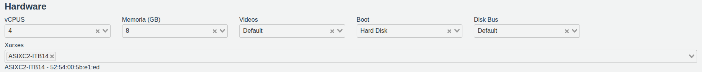
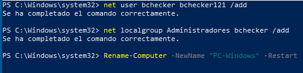
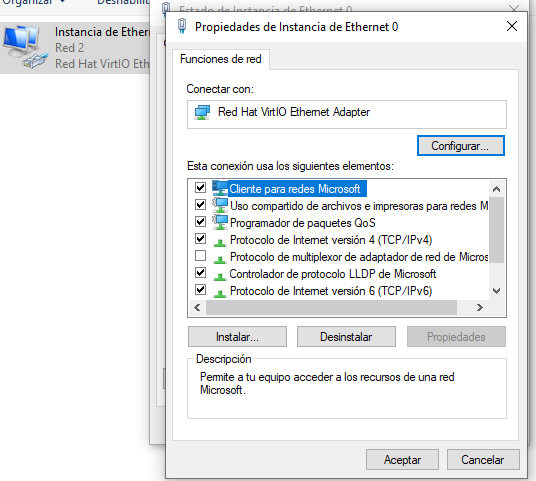
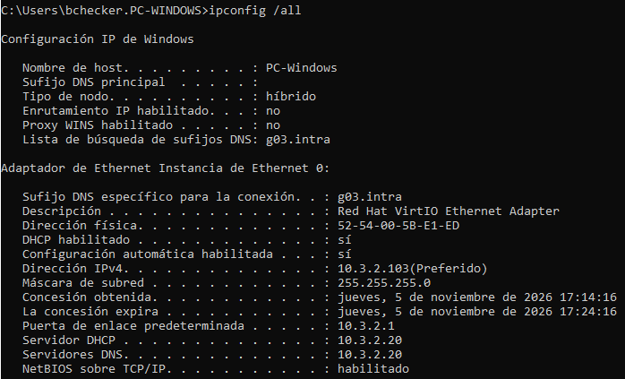
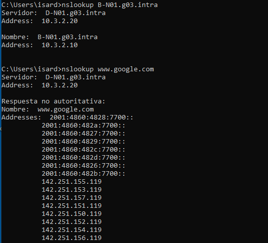
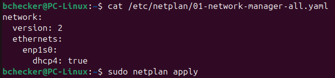
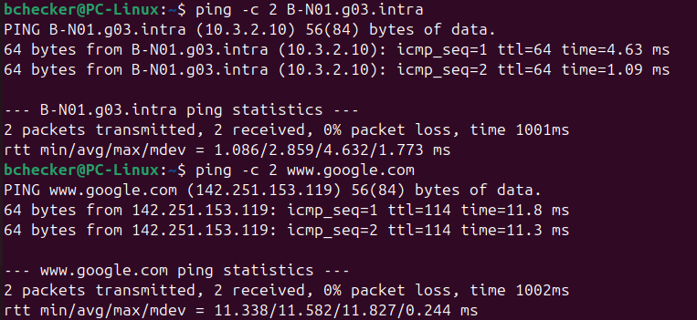
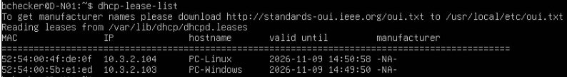

# 07 – Clients Windows i Linux

Els clients són els equips d'usuari de la Intranet. Serveixen per comprovar que la infraestructura funciona des del punt de vista d'un usuari: reben la configuració de xarxa per DHCP des de D-N01 i resolen noms amb el DNS del projecte. Hi ha un client Windows i un client Linux, perquè la prova cobreixi els dos sistemes operatius més habituals.

| Client | Hostname | Xarxa | Configuració de xarxa |
|---|---|---|---|
| PC Windows | `PC-Windows` | ASIXC2-ITB14 (Intranet) | DHCP |
| PC Linux | `PC-Linux` | ASIXC2-ITB14 (Intranet) | DHCP |

## 1. Creació de les màquines

Els dos clients s'han creat a IsardVDI a partir de les plantilles disponibles, sense crear-ne de noves. Cada client té **un únic adaptador**, a la xarxa ASIXC2-ITB14 (Intranet). No tenen la interfície Default ni ITB13: un client no ha de sortir a Internet directament ni estar a la DMZ. Tota la seva sortida passa pel router R-N01, igual que la resta de màquines internes.

### 1.1 Client Windows

| Adaptador | Xarxa d'Isard | MAC | Configuració |
|---|---|---|---|
| 1 | ASIXC2-ITB14 | 52:54:00:5b:e1:ed | DHCP |

La MAC coincideix amb l'adreça física que mostra `ipconfig /all` dins de Windows (`52-54-00-5B-E1-ED`). Això confirma que l'adaptador que rep la IP és el de la Intranet.



*Configuració de recursos i xarxa del client Windows a IsardVDI, amb només l'adaptador ASIXC2-ITB14.*

### 1.2 Client Linux

| Adaptador | Xarxa d'Isard | MAC | Configuració |
|---|---|---|---|
| 1 | ASIXC2-ITB14 | *pendent* | DHCP |


*Configuració de recursos i xarxa del client Linux a IsardVDI, amb només l'adaptador ASIXC2-ITB14.*

## 2. Configuració base

Com a la resta de màquines del projecte, els dos clients tenen l'usuari `bchecker` amb permisos d'administrador, perquè el professor hi pugui entrar per corregir, i un hostname que segueix la nomenclatura del projecte. La contrasenya de `bchecker` es comunica al professor per separat i no es publica en aquest repositori. Per això, a les ordres apareix com a `CONTRASENYA` i a les captures s'ha retallat.

### 2.1 Client Windows

Des de PowerShell oberta com a administrador:

```powershell
net user bchecker CONTRASENYA /add
net localgroup Administradores bchecker /add
Rename-Computer -NewName "PC-Windows" -Restart
```

- **`net user bchecker ... /add`** crea l'usuari local `bchecker` amb la seva contrasenya.
- **`net localgroup Administradores bchecker /add`** afegeix l'usuari al grup d'administradors locals, l'equivalent al grup `sudo` de Linux. El nom del grup depèn de l'idioma del sistema: en un Windows en anglès és `Administrators`.
- **`Rename-Computer -NewName "PC-Windows" -Restart`** canvia el nom de l'equip i el reinicia, perquè a Windows el nou nom no s'aplica fins al reinici.

**Comprovació.** Després del reinici, `hostname` ha de mostrar `PC-Windows`, i `net user bchecker` ha de mostrar el grup `*Administradores` entre els grups locals de l'usuari.



*Creació de l'usuari bchecker, afegit al grup d'administradors i canvi de hostname a PC-Windows.*

### 2.2 Client Linux

Des del terminal, amb un usuari amb permisos de sudo:

```bash
sudo useradd -m -s /bin/bash bchecker
sudo passwd bchecker
sudo usermod -aG sudo bchecker
sudo hostnamectl set-hostname PC-Linux
```

- **`useradd -m -s /bin/bash bchecker`** crea l'usuari amb el seu directori personal (`-m`) i amb bash com a intèrpret d'ordres (`-s`). Sense `-s`, `useradd` assigna `sh`, que és menys còmode per treballar.
- **`passwd bchecker`** li assigna la contrasenya. `useradd`, a diferència d'`adduser`, no la demana.
- **`usermod -aG sudo bchecker`** afegeix l'usuari al grup `sudo` perquè pugui administrar la màquina. L'opció `-a` evita que perdi la resta de grups.
- **`hostnamectl set-hostname PC-Linux`** canvia el nom de la màquina de forma persistent. Es veu al prompt quan es torna a iniciar sessió.

**Comprovació.** `hostnamectl` ha de mostrar `Static hostname: PC-Linux`, i `id bchecker` ha d'incloure el grup `sudo`.


*Creació de l'usuari bchecker amb permisos de sudo i canvi de hostname a PC-Linux.*

## 3. Serveis: client DHCP

**Què fa.** Cada client demana la configuració de xarxa a D-N01 quan arrenca. El servidor DHCP li assigna una IP del rang 10.3.2.100–200, el gateway 10.3.2.1 (R-N01), el DNS 10.3.2.20 (D-N01) i el domini `g03.intra`. Així els clients no necessiten cap configuració manual, i tots reben els mateixos paràmetres. Si un dia canvia el gateway o el DNS, només cal canviar-lo al servidor.

### 3.1 Client Windows

**Configuració.** L'adaptador de xarxa està en mode automàtic: *Obtenir una adreça IP automàticament* i *Obtenir l'adreça del servidor DNS automàticament*. És la configuració per defecte de Windows, i no s'ha introduït cap IP fixa.



*Propietats de l'adaptador de xarxa del client Windows en mode DHCP.*

**Comprovació.** Des de la consola, s'allibera la IP actual, se'n demana una de nova a D-N01 i es mostra la configuració completa rebuda:

```
ipconfig /release
ipconfig /renew
ipconfig /all
```

- **`ipconfig /release`** deixa anar la IP actual. Després d'aquesta ordre, l'adaptador es queda sense IP ni gateway.
- **`ipconfig /renew`** demana una IP nova al servidor DHCP. La resposta ja mostra la IP, el gateway i el sufix DNS rebuts.


*Alliberament i renovació de la IP al client Windows.*

La sortida de `ipconfig /all` mostra tota la configuració que ha assignat D-N01:

| Paràmetre | Valor obtingut | Coincideix amb D-N01 |
|---|---|---|
| Adreça IPv4 | 10.3.2.103 | Sí, dins del rang 10.3.2.100–200 |
| Màscara de subxarxa | 255.255.255.0 | Sí |
| Gateway | 10.3.2.1 | Sí, `option routers` |
| Servidor DHCP | 10.3.2.20 | Sí, és D-N01 |
| Servidors DNS | 10.3.2.20 | Sí, `option domain-name-servers` |
| Sufix DNS | g03.intra | Sí, `option domain-name` |
| DHCP habilitat | Sí | Sí |
| Concessió | 10 minuts (de 15:53 a 16:03) | Sí, `default-lease-time 600` |



*Sortida de `ipconfig /all` al client Windows amb la configuració rebuda de D-N01.*

**Resolució de noms.** Per comprovar que el DNS rebut funciona, es resol un nom intern i un d'extern:

```
nslookup B-N01.g03.intra
nslookup www.google.com
```

La primera consulta ha de respondre amb `10.3.2.10`, i la segona amb IPs públiques. A totes dues, el servidor que respon ha de ser `10.3.2.20`.



*Resolució d'un nom intern i un d'extern des del client Windows a través de D-N01.*

### 3.2 Client Linux

**Configuració.** L'adaptador de la Intranet està en mode DHCP, sense IP fixa ni DNS manual.



*Configuració de l'adaptador de xarxa del client Linux en mode DHCP.*

**Comprovació.** Des del terminal, es comprova la IP, la ruta per defecte i el DNS que ha rebut el client:

```bash
ip -br a
ip route
resolvectl status
```

- **`ip -br a`** mostra la IP de cada interfície en format resumit.
- **`ip route`** mostra la ruta per defecte, que ha d'anar pel gateway rebut per DHCP.
- **`resolvectl status`** mostra el servidor DNS i el domini de cerca que fa servir la interfície.

| Paràmetre | Valor esperat | Valor obtingut |
|---|---|---|
| Adreça IPv4 | Dins del rang 10.3.2.100–200 | *pendent* |
| Gateway (ruta per defecte) | 10.3.2.1 | *pendent* |
| Servidor DNS | 10.3.2.20 | *pendent* |
| Domini de cerca | g03.intra | *pendent* |


*Sortida de `ip -br a` i `ip route` al client Linux.*

**Resolució de noms.** Igual que amb Windows, es resol un nom intern i un d'extern:

```bash
ping -c 2 B-N01.g03.intra
ping -c 2 www.google.com
```

El primer `ping` ha de resoldre a `10.3.2.10` i respondre. El segon demostra que el client resol noms d'Internet a través de D-N01 i que hi surt pel router.



*Sortida de `resolvectl status` i dels `ping` per nom des del client Linux.*

### 3.3 Comprovació des del servidor DHCP

A D-N01 es pot veure quines IPs ha assignat i a quina MAC. Això demostra des del servidor que els dos clients han rebut la seva configuració:

```bash
dhcp-lease-list
```

Han d'aparèixer dues concessions: la MAC del client Windows amb la 10.3.2.103 i la del client Linux amb la seva IP. Si l'ordre no està disponible, es pot llegir directament el fitxer de concessions amb `sudo cat /var/lib/dhcp/dhcpd.leases`.



*Concessions actives al servidor DHCP de D-N01, amb els dos clients.*
