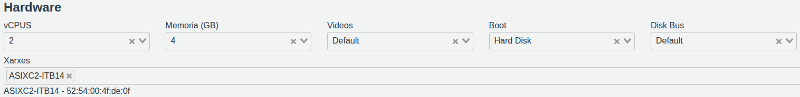
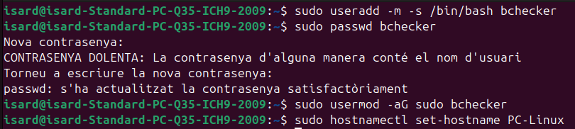
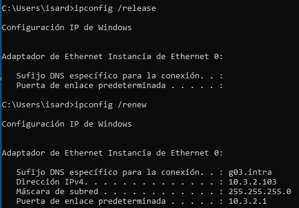
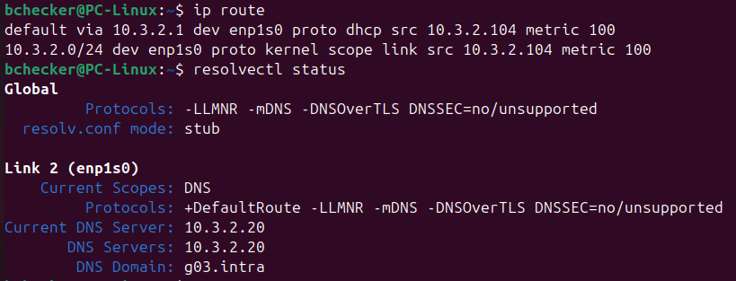

# 07 – Clients Windows i Linux

Els clients són les màquines de la Intranet que reben la configuració de xarxa per DHCP des de D-N01. Només tenen l'adaptador de la Intranet (ASIXC2-ITB14), i la prova consisteix a comprovar que obtenen IP del rang, gateway i DNS correctes, i que poden resoldre els noms del projecte.

## 1. Creació de la màquina

Els dos clients es creen a IsardVDI, cadascun amb un únic adaptador a la Intranet. No tenen la interfície Default ni ITB13, perquè no han de sortir directament a Internet ni estar a la DMZ: la sortida la fa el router.

| Client | Adaptador | Xarxa d'Isard | MAC | Configuració |
|---|---|---|---|---|
| PC Windows | 1 | ASIXC2-ITB14 | 52:54:00:5B:E1:ED | DHCP |
| PC Linux | 1 | ASIXC2-ITB14 | Pendent | DHCP |


*Configuració de xarxa del client Windows a IsardVDI.*



*Configuració de xarxa del client Linux a IsardVDI.*

## 2. Configuració base

### 2.1 Usuari bchecker i hostname al client Windows

Com a les altres màquines, el client Windows ha de tenir l'usuari `bchecker` amb permisos d'administrador i hostname personalitzat. Des de PowerShell oberta com a administrador:

```powershell
net user bchecker CONTRASENYA /add
net localgroup Administradores bchecker /add
Rename-Computer -NewName "PC-Windows" -Restart
```


*Creació de l'usuari bchecker i afegit al grup d'administradors i hostname.*

### 2.2 Configuració base del client Linux

S'ha creat l'usuari bchecker al client Linux amb permisos d'administrador i s'ha editat el hostname de la màquina a PC-Linux

```bash
sudo useradd -m -s /bin/bash bchecker
sudo passwd bchecker
sudo usermod -aG sudo bchecker
sudo hostnamectl set-hostname PC-Linux
```



*Creació de l'usuari bchecker amb permisos de sudo i canvi de hostname*

## 3. Serveis

### 3.1 Client DHCP Windows

**Què fa.** El client demana la seva configuració de xarxa a D-N01. Rep una IP del rang 10.3.2.100–200, el gateway 10.3.2.1 i el DNS 10.3.2.20. D'aquesta manera, el client no necessita cap configuració manual i rep els mateixos paràmetres que la resta de la Intranet.

**Configuració.** L'adaptador està en mode automàtic (DHCP), i no té IP fixa. A Windows és la configuració per defecte.


*Adaptador de xarxa del client Windows en DHCP*

**Comprovació.** Des de la consola de Windows, es demana una IP nova i es comprova la configuració rebuda:

```
ipconfig /release
ipconfig /renew
ipconfig /all
```



*Alliberament i renovació d'Ip*

| Paràmetre | Valor obtingut |
|---|---|
| Adreça IPv4 | 10.3.2.103 |
| Màscara de subxarxa | 255.255.255.0 |
| Gateway | 10.3.2.1 |
| Servidor DHCP | 10.3.2.20 |
| Servidor DNS | 10.3.2.20 |
| Sufix DNS | g03.intra |
| Concessió | 10 minuts (de 15:53 a 16:03), d'acord amb `default-lease-time 600` |

La IP està dins del rang del DHCP i els paràmetres coincideixen amb la configuració de D-N01.


*Sortida de `ipconfig /all` al client Windows.*

### 3.2 Client DHCP Linux

**Què fa.** El client demana la seva configuració de xarxa a D-N01. Rep una IP del rang 10.3.2.100–200, el gateway 10.3.2.1 i el DNS 10.3.2.20. Igual que el client Windows, no necessita cap configuració manual.

**Configuració.** L'adaptador de la Intranet (`enp1s0`) està en mode DHCP, sense IP fixa. Al fitxer de netplan (`/etc/netplan/50-cloud-init.yaml`) només hi ha `dhcp4: true` per a aquesta interfície:

```yaml
network:
  version: 2
  ethernets:
    enp1s0:
      dhcp4: true
```

Després d'editar el fitxer, s'aplica la configuració amb `sudo netplan apply`.


*Fitxer de netplan del client Linux amb l'adaptador en DHCP.*

**Comprovació.** Des del terminal del client Linux, es comprova la IP, la ruta per defecte i el DNS rebuts:

```bash
ip -br a
ip route
resolvectl status enp1s0
ping -c 2 D-N01.g03.intra
```

| Paràmetre | Valor esperat | Valor obtingut |
|---|---|---|
| Adreça IPv4 (`enp1s0`) | 10.3.2.100–200 | *pendent* |
| Gateway (ruta per defecte) | 10.3.2.1 | *pendent* |
| Servidor DNS | 10.3.2.20 | *pendent* |
| Sufix DNS | g03.intra | *pendent* |

La IP ha d'estar dins del rang del DHCP, i els paràmetres han de coincidir amb la configuració de D-N01. El `ping` a `D-N01.g03.intra` demostra que el client resol noms a través del DNS.



*Sortida de `ip -br a` i `ip route` al client Linux.*


*Sortida de `resolvectl status` i `ping` a `D-N01.g03.intra`.*
