# 09 – Bateria de proves

Aquest document recull les proves que validen la infraestructura de principi a fi: que cada servei funciona, que les xarxes es comuniquen només com estableix el disseny, i que el sistema respon amb un rendiment acceptable i es recupera sol després d'un reinici. Cada prova indica des d'on es fa, l'ordre exacta, el resultat esperat, el resultat obtingut i la captura que ho demostra.

Algunes proves es van fer en configurar cada servei. Aquí se'n recull igualment l'ordre, el resultat i la captura, perquè aquest document es pugui comprovar sencer sense haver de consultar-ne cap altre.

## 1. Metodologia

- **Des d'on es prova.** Les proves de servei es fan des d'una màquina diferent de la que ofereix el servei, i sempre que es pot, des d'un client de la Intranet, que és el punt de vista de l'usuari. Les proves del tallafocs es fan des de la DMZ, perquè el trànsit que surt del mateix router no passa per la cadena `FORWARD`.
- **Usuari.** Totes les proves es fan amb l'usuari `bchecker`, el mateix que fa servir el professor.
- **Criteri d'èxit.** Una prova és correcta quan el resultat obtingut coincideix amb l'esperat. Si no coincideix, s'anota la incidència i com s'ha resolt.
- **Ordre d'arrencada.** Abans de les proves, les màquines s'engeguen en aquest ordre: R-N01, D-N01, B-N01, W-N01, F-N01 i els clients. El router ha d'anar primer perquè tota la resta en depèn, i D-N01 abans dels clients perquè rebin IP.

## 2. Proves funcionals

### 2.1 Accés amb l'usuari bchecker

**Què es prova.** Que l'usuari `bchecker` existeix a tots els equips i hi pot entrar, tal com exigeix l'enunciat.

| ID | Prova | Des d'on | Ordre | Esperat |
|---|---|---|---|---|---|
| P01 | SSH a R-N01 | PC-Linux | `ssh bchecker@10.3.2.1` | `R-N01` |
| P02 | SSH a D-N01 | PC-Linux | `ssh bchecker@10.3.2.20` | `D-N01` |
| P03 | SSH a B-N01 | PC-Linux | `ssh bchecker@10.3.2.10 ` | `B-N01` |
| P04 | SSH a W-N01 | PC-Linux | `ssh bchecker@10.3.1.20` | `W-N01` |
| P05 | SSH a F-N01 | PC-Linux | `ssh bchecker@10.3.1.10` | `F-N01` |
| P06 | Usuari bchecker al client Windows | PC-Windows | `net user bchecker` i iniciar sessió com a `bchecker` | Usuari al grup `Administradores` i sessió iniciada | Usuari creat i afegit a `Administradores`. La consola mostra `C:\Users\bchecker>` |
| P07 | Usuari bchecker a MySQL | B-N01 | `mysql -u bchecker -p -e "SHOW DATABASES;"` | Apareix `equipaments` | Apareix `equipaments` |

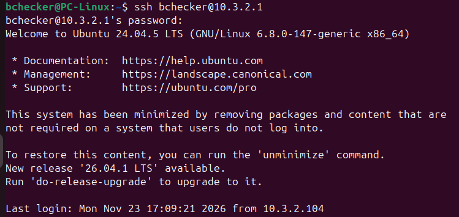
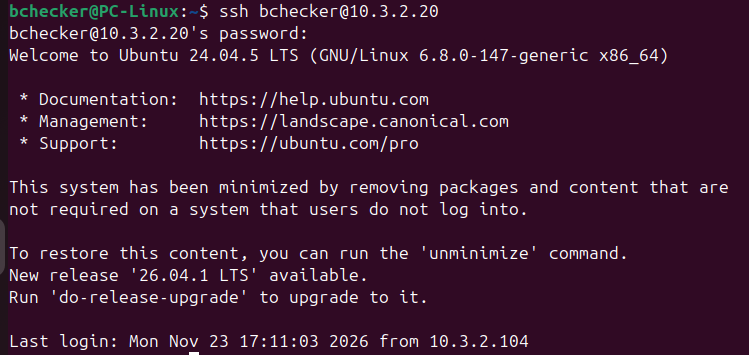

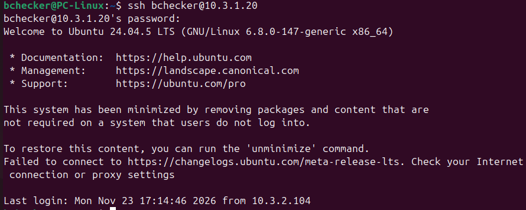
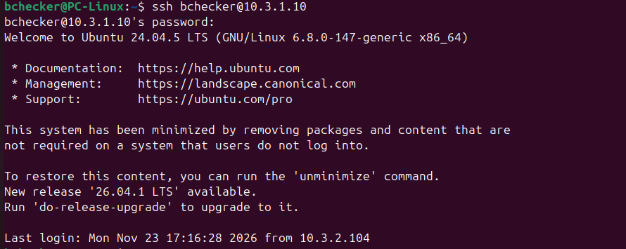

*Connexió per SSH amb bchecker des de PC-Linux a cada servidor.*

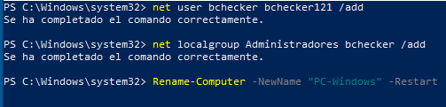

*Creació de l'usuari bchecker al client Windows i afegit al grup d'administradors.*

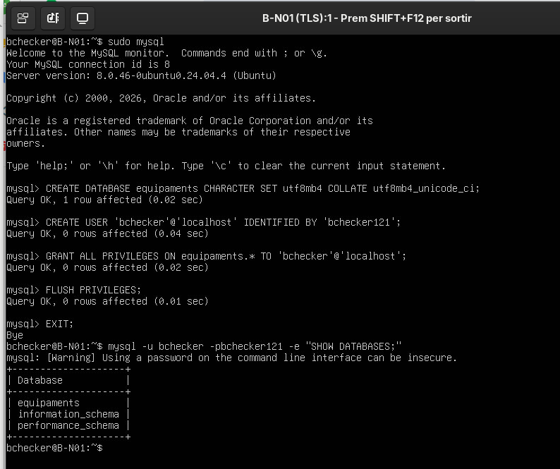

*L'usuari bchecker veu la base de dades equipaments.*

### 2.2 DHCP

**Què es prova.** Que els clients de la Intranet reben automàticament una IP del rang, el gateway, el DNS i el domini, i que el servidor registra les concessions.

| ID | Prova | Des d'on | Ordre | Esperat | Obtingut |
|---|---|---|---|---|---|
| P08 | Configuració rebuda al Windows | PC-Windows | `ipconfig /all` | IP del rang 10.3.2.100–200, gateway 10.3.2.1, DNS 10.3.2.20, sufix `g03.intra` | 10.3.2.103, 10.3.2.1, 10.3.2.20, `g03.intra` |
| P09 | Configuració rebuda al Linux | PC-Linux | `ip -br a`, `ip route`, `resolvectl status` | P del rang 10.3.2.100–200, gateway 10.3.2.1, DNS 10.3.2.20, sufix g03.intra | 10.3.2.104, 10.3.2.1, 10.3.2.20, `g03.intra` |
| P10 | Concessions al servidor | D-N01 | `dhcp-lease-list` | `52:54:00:5b:e1:ed` (Windows) → 10.3.2.103 i `52:54:00:4f:de:0f` (Linux) → 10.3.2.104 | `52:54:00:5b:e1:ed` → 10.3.2.103 (`PC-Windows`) i `52:54:00:4f:de:0f` → 10.3.2.104 (`PC-Linux`) |

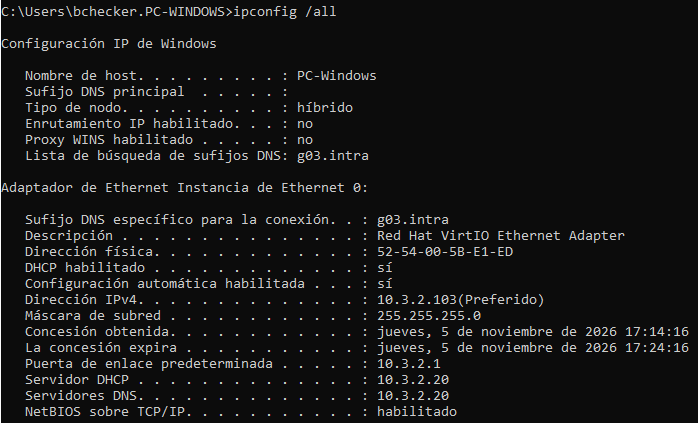

*Configuració rebuda pel client Windows.*

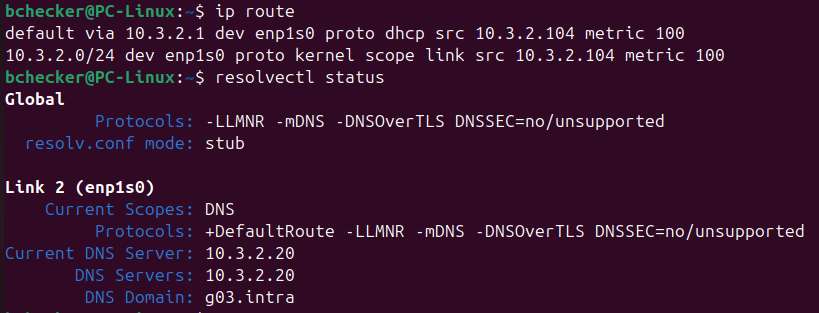

*Configuració rebuda pel client Linux.*

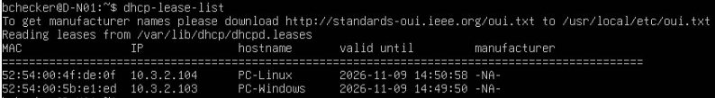

*Concessions actives a D-N01.*

### 2.3 DNS

**Què es prova.** Que D-N01 resol els noms del projecte (directes, àlies i inversos) i els d'Internet, tant des de la Intranet com des de la DMZ. L'enunciat demana explícitament que resolgui `R-N01` i `R`.

| ID | Prova | Des d'on | Ordre | Esperat | Obtingut |
|---|---|---|---|---|---|
| P11 | Registres al mateix servidor | D-N01 | `dig @10.3.2.20 D-N01.g03.intra +short`<br>`dig @10.3.2.20 R.g03.intra +short`<br>`dig @10.3.2.20 -x 10.3.2.10 +short`<br>`dig @10.3.2.20 www.google.com +short` | `10.3.2.20`, àlies a `10.3.2.1`, `B-N01.g03.intra.` i IPs públiques | `10.3.2.20`; `R-N01.g03.intra.` i `10.3.2.1`; `B-N01.g03.intra.`; diverses IPs 142.251.x.x |
| P12 | Nom del router | PC-Linux | `dig R-N01.g03.intra +short` | `10.3.2.1` | `10.3.2.` |
| P13 | Àlies del router | PC-Linux | `dig R.g03.intra +short` | `R-N01.g03.intra.` i `10.3.2.1` | `R-N01.g03.intra.` i `10.3.2.1` |
| P14 | Resolució inversa d'una màquina de la DMZ | PC-Linux | `dig -x 10.3.1.20 +short` | `W-N01.g03.intra.` | `W-N01.g03.intra.` |
| P15 | Nom intern i extern des del Windows | PC-Windows | `nslookup B-N01.g03.intra`<br>`nslookup www.google.com` | `10.3.2.10` i IPs públiques, servidor `10.3.2.20` | *per confirmar a la captura* |
| P16 | DNS des de la DMZ | W-N01 | `dig B-N01.g03.intra +short` | `10.3.2.10` (el tallafocs permet el port 53 de la DMZ cap a D-N01) | `10.3.2.10` |

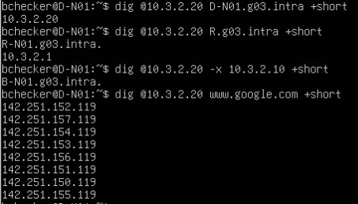

*Respostes del DNS des del mateix servidor.*

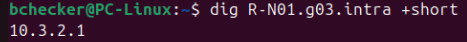

*resolució de R-N01*

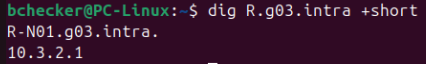

*Àlies del router*

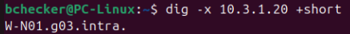

*Resolució inversa d'una màquina de la DMZ*


*Resolució de R-N01, l'àlies R i el PTR de W-N01 des de PC-Linux.*

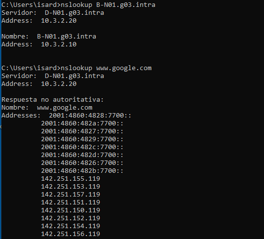

*Resolució de noms des del client Windows.*

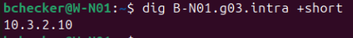

*Resolució de noms des de W-N01, a la DMZ.*

### 2.4 Router i NAT

**Què es prova.** Que les màquines internes surten a Internet passant pel router, i que el router fa NAT.

| ID | Prova | Des d'on | Ordre | Esperat | Obtingut |
|---|---|---|---|---|---|
| P17 | Sortida a Internet pel router | PC-Linux | `ip route get 8.8.8.8 tracepath -n -m 3 8.8.8.8` | La ruta va via `10.3.2.1` i el primer salt és `10.3.2.1` | `8.8.8.8 via 10.3.2.1 dev enp1s0 src 10.3.2.104`. Salts: 1 `10.3.2.1` (R-N01), 2 `192.168.120.1` (NAT d'Isard), 3 `172.31.255.1` |
| P18 | NAT | W-N01 i R-N01 | `ping -c 3 8.8.8.8` i, al router, `sudo iptables -t nat -L POSTROUTING -n -v` | El comptador de `MASQUERADE` puja | 6 paquets, un per cada ping fet des de W-N01 |

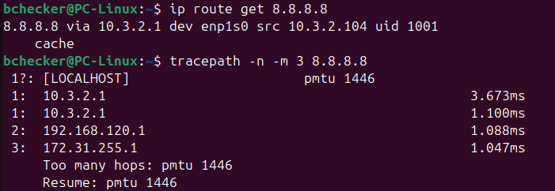

*El primer salt cap a Internet és el router.*

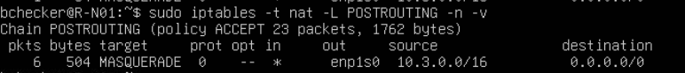

*Comptador de la regla MASQUERADE.*

### 2.5 Tallafocs

**Què es prova.** Que de la DMZ cap a la Intranet només passa el trànsit permès (W-N01 → B-N01 pel 3306 i DMZ → D-N01 pel 53), i que la Intranet pot accedir a la DMZ.

| ID | Prova | Des d'on | Ordre | Esperat | Obtingut |
|---|---|---|---|---|---|
| P19 | DMZ → Intranet (ping) | F-N01 | `ping -c 2 -W 2 10.3.2.10` | Bloquejat | 100% packet loss |
| P20 | DMZ → MySQL des d'una màquina no autoritzada | F-N01 | `nc -zv -w 3 10.3.2.10 3306` | Bloquejat | `timed out` |
| P21 | DMZ → DNS | F-N01 | `dig @10.3.2.20 B-N01.g03.intra +short` | Permès | `10.3.2.10` |
| P22 | Web → MySQL | W-N01 | `nc -zv -w 3 10.3.2.10 3306` | Permès | `succeeded` |
| P23 | Web → Intranet (ping) | W-N01 | `ping -c 2 -W 2 10.3.2.10` | Bloquejat | 100% packet loss |
| P24 | Intranet → DMZ | PC-Linux | `ping -c 2 10.3.1.20` | Permès | Respon, `ttl=63` |
| P25 | Comptadors de les regles | R-N01 | `sudo iptables -L FORWARD -n -v --line-numbers` | Paquets a les regles 2, 3 i 5 | 1, 2 i 12 paquets |

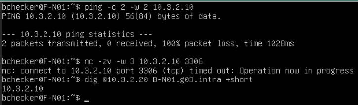

*Proves des de F-N01.*

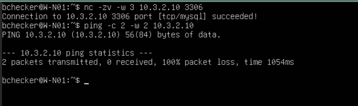

*Proves des de W-N01.*

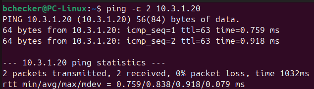

*Prova des de PC-Linux.*

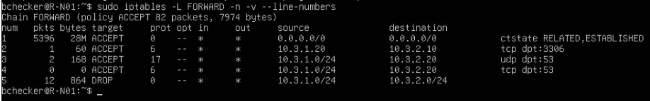

*Comptadors de la cadena FORWARD després de les proves.*

### 2.6 Base de dades

**Què es prova.** Que les dades del CSV són a MySQL, i que l'aplicació hi accedeix amb un usuari de només lectura, només des de W-N01.

| ID | Prova | Des d'on | Ordre | Esperat | Obtingut |
|---|---|---|---|---|---|
| P26 | Registres carregats | B-N01 | `SELECT COUNT(*) FROM equipaments_educacio;` | `2710`, amb accents i codis postals correctes | `2710`; codis postals `08024`, `08030`, `08038`; `Institut Escola El Til·ler` correcte |
| P27 | Accés de l'aplicació | W-N01 | `mysql -h 10.3.2.10 -u appweb -p equipaments -e "SELECT COUNT(*) FROM equipaments_educacio;"` | `2710` | *per confirmar a la captura* |
| P28 | L'usuari de l'aplicació no pot escriure | W-N01 | `mysql -h 10.3.2.10 -u appweb -p equipaments -e "DELETE FROM equipaments_educacio LIMIT 1;"` | `ERROR 1142`: ordre DELETE denegada | *pendent* |

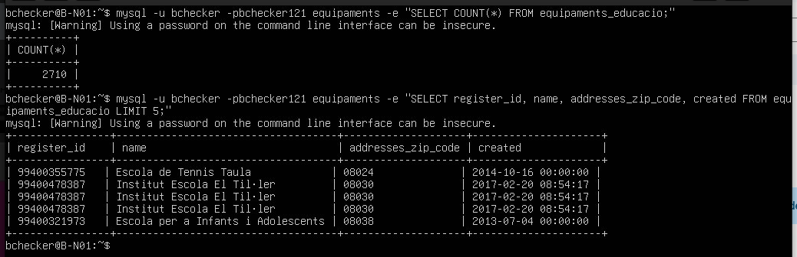

*Recompte de registres i mostra de dades a B-N01.*

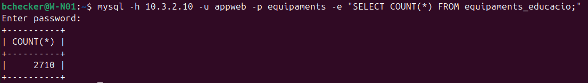

*Consulta des de W-N01 amb l'usuari appweb.*

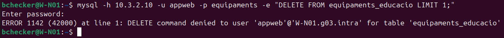

*L'usuari appweb no pot modificar dades.*

### 2.7 Web i aplicació

**Què es prova.** Que l'aplicació és accessible des d'un client pel nom del servidor, i que totes les seves funcions treballen.

| ID | Prova | Des d'on | Acció | Esperat | Obtingut |
|---|---|---|---|---|---|
| P29 | Accés pel nom | PC-Linux (navegador) | Obrir `http://W-N01` | Es mostra l'aplicació, no la pàgina d'Apache | *pendent* |
| P30 | Cercador | PC-Linux (navegador) | Cercar `escola` | El llistat i el comptador de resultats canvien | *pendent* |
| P31 | Filtres i paginació | PC-Linux (navegador) | Filtrar per un districte i passar a la pàgina 2 | El filtre es manté en canviar de pàgina | *pendent* |
| P32 | Fitxa de detall | PC-Linux (navegador) | Obrir el primer equipament del llistat | Es mostra la fitxa, amb accents correctes | *pendent* |


*Aplicació carregada amb http://W-N01 des de PC-Linux.*


*Cerca i filtre per districte, a la pàgina 2.*

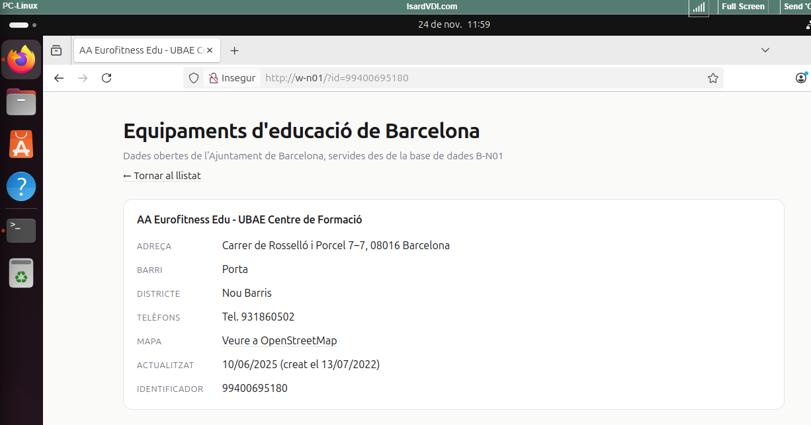

*Fitxa de detall del primer equipament.*

### 2.8 FTP

**Què es prova.** Que un usuari de la Intranet pot pujar i baixar fitxers a F-N01, sense sortir de la seva carpeta.

| ID | Prova | Des d'on | Ordre | Esperat | Obtingut |
|---|---|---|---|---|---|
| P33 | Pujada i baixada | PC-Linux | `lftp -u bchecker 10.3.1.10`, `put`, `get` | El fitxer fa el viatge sencer | `put`: `9 bytes transferred`; el fitxer baixat conté `PC-Linux` |
| P34 | Engabiament (chroot) | PC-Linux | `ls` a l'arrel de l'FTP | Només es veu `files` | Només es veu `files`. L'usuari no pot sortir de la seva carpeta |


*Pujada i baixada per FTP des de PC-Linux.*

## 3. Rendiment

**Criteris.** S'han definit tres límits a partir del que espera un usuari d'una aplicació de consulta. Per sota d'un segon, la resposta d'una pàgina es percep com a immediata. El DNS ha de ser molt més ràpid, perquè cada visita en fa una consulta abans de començar.

| Criteri | Límit | Com es mesura |
|---|---|---|
| Temps de resposta del web | < 1 s | `curl` des de PC-Linux, 5 peticions |
| Temps de resposta del DNS intern | < 50 ms | `Query time` de `dig` des de PC-Linux |
| Temps d'una consulta a MySQL | < 1 s | `time mysql` des de W-N01 |

**Ordres.**

```bash
# PC-Linux: temps de resposta del web (5 peticions)
for i in 1 2 3 4 5; do curl -o /dev/null -s -w '%{time_total}\n' http://10.3.1.20/; done

# PC-Linux: temps de resposta del DNS, intern i extern
dig B-N01.g03.intra | grep "Query time"
dig www.google.com | grep "Query time"

# W-N01: temps d'una consulta a MySQL
time mysql -h 10.3.2.10 -u appweb -p equipaments -e "SELECT COUNT(*) FROM equipaments_educacio;"
```

| ID | Prova | Límit | Obtingut | Compleix |
|---|---|---|---|---|
| P35 | Temps de resposta del web (mitjana de 5) | < 1 s | *pendent* | *pendent* |
| P36 | DNS intern | < 50 ms | *pendent* | *pendent* |
| P37 | DNS extern (primera consulta, sense memòria cau) | Informatiu | *pendent* | — |
| P38 | Consulta a MySQL des de W-N01 | < 1 s | *pendent* | *pendent* |

La consulta d'un nom extern (P37) és més lenta la primera vegada perquè D-N01 l'ha de demanar a 8.8.8.8. Les següents vegades la respon de la memòria cau. Es mesura només com a informació, perquè depèn de la connexió d'Isard.

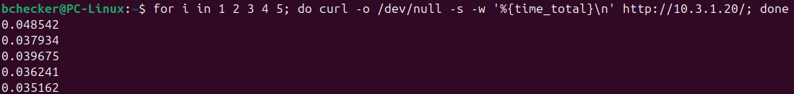

*Temps de resposta de 5 peticions al web.*

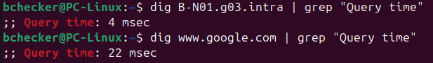

*Temps de resposta del DNS intern i extern.*

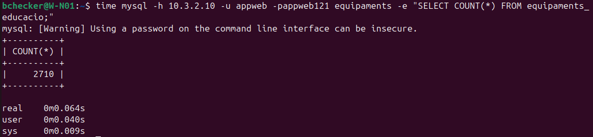

*Temps d'una consulta a MySQL des de W-N01.*

## 4. Disponibilitat

**Criteri.** Després d'un reinici, cada servidor ha de tornar a oferir el seu servei sense cap intervenció manual. Això demostra que els serveis estan activats a l'arrencada (`enabled`) i que la configuració del router (reenviament, NAT i tallafocs) és persistent.

**Ordres**, després de `sudo reboot` a cada servidor:

```bash
# R-N01
sysctl net.ipv4.ip_forward
sudo iptables -L FORWARD -n --line-numbers
sudo iptables -t nat -L POSTROUTING -n

# D-N01
systemctl is-active isc-dhcp-server named
systemctl is-enabled isc-dhcp-server named

# B-N01, W-N01 i F-N01
systemctl is-active mysql;   systemctl is-enabled mysql
systemctl is-active apache2; systemctl is-enabled apache2
systemctl is-active vsftpd;  systemctl is-enabled vsftpd
```

| ID | Prova | Màquina | Esperat | Obtingut |
|---|---|---|---|---|
| P39 | Reenviament i regles persistents | R-N01 | `ip_forward = 1`, les 5 regles de `FORWARD` i la de `MASQUERADE` | *pendent* |
| P40 | DHCP i DNS arrenquen sols | D-N01 | `active` i `enabled` | *pendent* |
| P41 | MySQL arrenca sol | B-N01 | `active` i `enabled` | *pendent* |
| P42 | Apache arrenca sol | W-N01 | `active` i `enabled` | *pendent* |
| P43 | vsftpd arrenca sol | F-N01 | `active` i `enabled` | *pendent* |

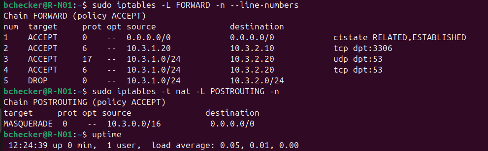

*Configuració del router després de reiniciar.*


*Estat dels serveis després de reiniciar cada servidor.*

### Punts únics de fallada

Dues màquines no tenen substitut, i si cauen afecten tota la infraestructura:

| Màquina | Si cau… | Efecte |
|---|---|---|
| R-N01 | Cap màquina surt a Internet i la DMZ i la Intranet queden aïllades | Tota la infraestructura queda fora de servei |
| D-N01 | Els clients no resolen noms | La web continua funcionant per IP. Els clients conserven la IP fins que caduca la concessió |

La concessió del DHCP dura 10 minuts (`default-lease-time 600`). Per tant, si D-N01 cau més de 10 minuts, els clients es queden sense IP. Una concessió més llarga (per exemple, d'un dia) donaria més marge per recuperar el servidor, a canvi de trigar més a alliberar les IPs que no es fan servir.

## 5. Resum

| Bloc | Proves | Correctes | Pendents |
|---|---|---|---|
| Accés amb bchecker | P01–P07 | 2 | 5 |
| DHCP | P08–P10 | 2 | 1 |
| DNS | P11–P16 | 1 | 5 |
| Router i NAT | P17–P18 | 1 | 1 |
| Tallafocs | P19–P25 | 7 | 0 |
| Base de dades | P26–P28 | 1 | 2 |
| Web i aplicació | P29–P32 | 0 | 4 |
| FTP | P33–P34 | 2 | 0 |
| Rendiment | P35–P38 | 0 | 4 |
| Disponibilitat | P39–P43 | 0 | 5 |
| **Total** | **43** | **16** | **27** |

### Incidències detectades durant les proves

| Incidència | Causa | Solució |
|---|---|---|
| B-N01 no podia fer ping a W-N01 | La resposta de W-N01 sortia per l'adaptador de la VPN, perquè la ruta `10.0.0.0/14` de la VPN inclou les 10.3.2.x | Ruta explícita `10.3.2.0/24 via 10.3.1.1` al netplan de W-N01 |
| El comptador del NAT es quedava a 0 | W-N01 encara tenia la ruta per defecte per la Default | Ruta per defecte via 10.3.1.1 |
